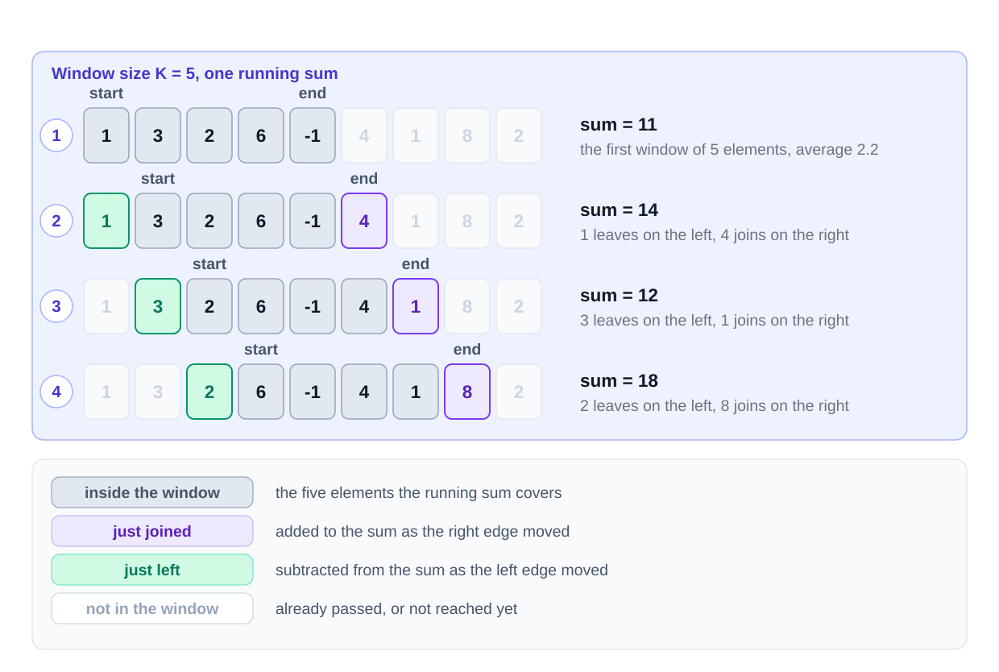

## Introduction to Sliding Window Pattern


You are given an array and a number `K`. Find the average of every group of `K` neighbouring values.

```
[1, 3, 2, 6, -1, 4, 1, 8, 2]     K = 5
```

The word **neighbouring** is important. The values in each group must be next to one another. Such a group is called a **contiguous subarray**.

A simple solution starts at every index. It adds the next `K` values and divides the sum by `K`.

This repeats a large amount of work. For every starting position, it performs `K` additions. The time complexity is `O(N * K)`.

Now compare the first two groups:

```
[1, 3, 2, 6, -1]
   [3, 2, 6, -1, 4]
```

Four values appear in both groups. We should not add those four values again.

Instead, keep the sum of the current group. When the group moves one step right:

1. Subtract the value that leaves from the left.
2. Add the new value that enters from the right.

This moving group is called a **window**. Updating its two edges changes `O(N * K)` work into `O(N)` work.

## Core idea

The **Sliding Window pattern** keeps a contiguous range over an array or string.

The window has a left boundary and a right boundary. It also keeps a small summary of the values inside it.

The summary may be a sum, a count, a product, or a frequency map. We update the summary when values enter or leave the window.

## How it works

For a fixed window of size `K`, follow these steps:

1. Set the running sum to zero.
2. Move the right boundary through the array.
3. Add the new value to the running sum.
4. When the window contains `K` values, record the average.
5. Subtract the value at the left boundary.
6. Move the left boundary one step right.
7. Continue until the right boundary reaches the end.



Some problems do not give a fixed size. The window grows while it is valid. When it becomes invalid, move the left boundary until it is valid again.

Each value enters the window at most once. Each value also leaves at most once. Both boundaries move only from left to right.

Therefore, the total time complexity is usually `O(N)`.

A variable-size solution may contain a loop inside another loop. It is still `O(N)` because the left boundary never returns to an earlier index.

## Recognize it when

Sliding Window may be useful when:

- The problem asks about a **contiguous subarray** or **contiguous substring**.
- The question asks for the **longest** or **shortest** valid range.
- The question asks for the **maximum** or **minimum** value across ranges.
- The problem gives a fixed size such as `K`.
- Your first solution starts at each index and scans forward again.
- A small summary can describe the current range.

Words such as "consecutive," "neighbouring," and "substring" are strong signals. They tell you that values cannot be skipped.

Do **not** use this pattern when:

- Values may be skipped. That creates a subsequence and often needs **Dynamic Programming**.
- You need a pair or triplet in a sorted array. Use **Two Pointers**.
- You need answers for many independent range-sum queries. Use **Prefix Sum**.
- You need the maximum or minimum value inside every window. A **Monotonic Queue** may be better.

## The template

This template handles a window whose size changes:

```js
function slidingWindow(input):
    windowStart = 0
    summary = empty
    best = starting value

    for windowEnd from 0 to length(input) - 1:
        add input[windowEnd] to summary

        while window is not valid:
            remove input[windowStart] from summary
            windowStart = windowStart + 1

        best = update answer using current window

    return best
```

Three parts change from problem to problem:

1. The summary that describes the window.
2. The condition that says whether the window is valid.
3. The answer that you record.

Use `while` when shrinking a variable-size window. One removal may not make the window valid again.

For a fixed-size window, shrink when its length becomes greater than `K`.

The current window length is:

```
windowEnd - windowStart + 1
```

## Variants in this chapter

| Variant | How the window behaves | Problems in this chapter |
|---|---|---|
| Fixed size | the window always contains `K` values | [Maximum Sum Subarray of Size K](/course-play/grokking-the-coding-interview/doc/maximum-sum-subarray-of-size-k-easy) |
| Smallest valid window | grow until valid, then shrink while it remains valid | [Smallest Subarray With a Greater Sum](/course-play/grokking-the-coding-interview/doc/smallest-subarray-with-a-greater-sum-easy) |
| Largest valid window | grow normally and shrink when the window becomes invalid | [Longest Substring with K Distinct Characters](/course-play/grokking-the-coding-interview/doc/longest-substring-with-k-distinct-characters-medium), [Fruits into Baskets](/course-play/grokking-the-coding-interview/doc/fruits-into-baskets-medium), [Longest Substring with Same Letters after Replacement](/course-play/grokking-the-coding-interview/doc/longest-substring-with-same-letters-after-replacement-hard), [Longest Subarray with Ones after Replacement](/course-play/grokking-the-coding-interview/doc/longest-subarray-with-ones-after-replacement-hard) |
| Frequency matching | a map tracks how many times each character appears | [Permutation in a String](/course-play/grokking-the-coding-interview/doc/problem-challenge-1-permutation-in-a-string-hard), [String Anagrams](/course-play/grokking-the-coding-interview/doc/problem-challenge-2string-anagrams-hard), [Smallest Window containing Substring](/course-play/grokking-the-coding-interview/doc/problem-challenge-3-smallest-window-containing-substring-hard), [Words Concatenation](/course-play/grokking-the-coding-interview/doc/problem-challenge-4-words-concatenation-hard) |
| Count valid windows | every valid window adds to a total | [Counting Subarrays with Product Less than a Target](/course-play/grokking-the-coding-interview/doc/problem-challenge-5-counting-subarrays-with-product-less-than-a-target-medium), [Subarrays with Product Less than a Target](/course-play/grokking-the-coding-interview/doc/problem-challenge-6-subarrays-with-product-less-than-a-target-medium) |

Start with the fixed-size version. Then learn how to grow and shrink a variable-size window.

## Watch out for

- **Using `if` instead of `while`.** A variable-size window may need several removals.
- **Forgetting the outgoing value.** Remove it from the sum, count, product, or frequency map.
- **Using the wrong window length.** Include `+ 1` because both boundary positions belong to the window.
- **Deleting a frequency too early.** Reduce its count first, and delete the key only when the count becomes zero.
- **Scanning the full frequency map on every step.** Keep a separate count of satisfied requirements when possible.
- **Calling the algorithm `O(N )` because it has two loops.** Each boundary moves at most `N` times.

## How this compares with nearby patterns

| If the problem needs... | Use... |
|---|---|
| a contiguous range that grows or shrinks | Sliding Window |
| a pair or triplet in a sorted array | Two Pointers |
| sums for many separate fixed ranges | Prefix Sum |
| a maximum or minimum inside every window | Monotonic Queue |

Sliding Window and Two Pointers both use two indices. Their indices represent different things.

In Sliding Window, the indices are the boundaries of one contiguous range. In Two Pointers, the indices usually identify two values being compared.

## Key takeaways

- A sliding window always represents a contiguous range.
- Update a small summary when values enter or leave the window.
- Each boundary moves only forward, so the total work is usually `O(N)`.
- Use `while` when one removal may not make a variable-size window valid.
- The summary, validity condition, and recorded answer change between problems.
- If values may be skipped, Sliding Window is usually not the correct pattern.

Now apply this pattern to [Maximum Sum Subarray of Size K](/course-play/grokking-the-coding-interview/doc/maximum-sum-subarray-of-size-k-easy).
