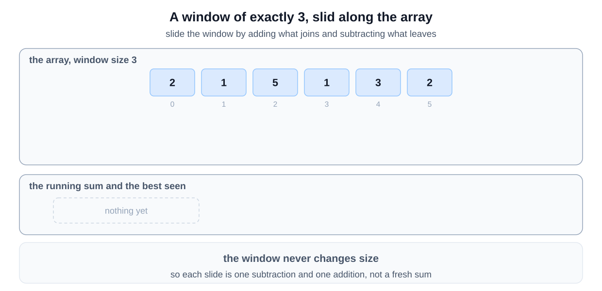
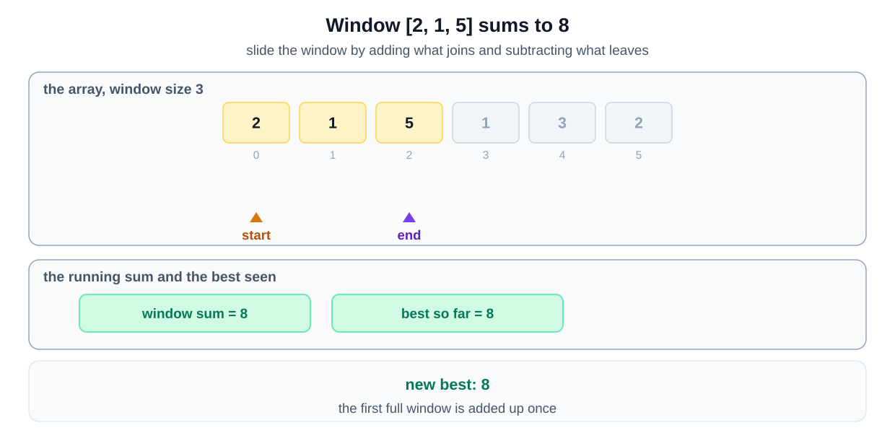
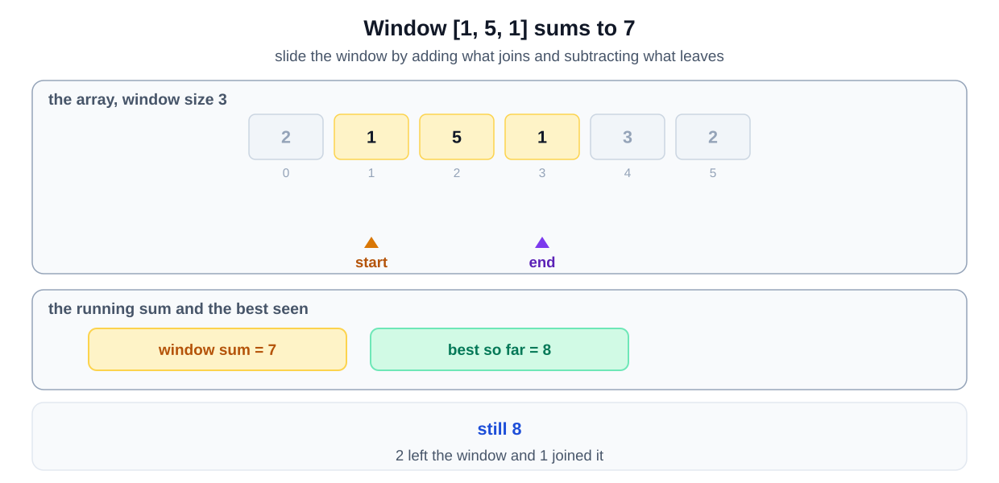
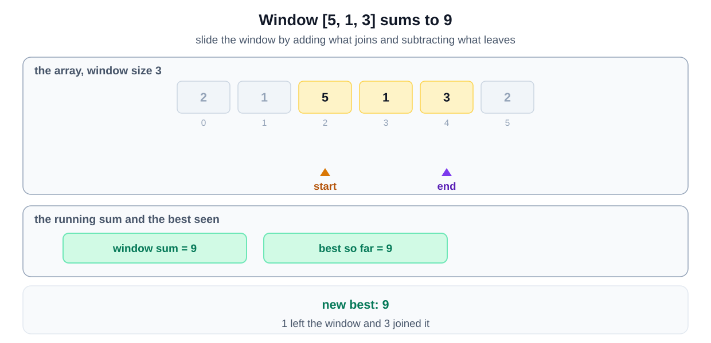
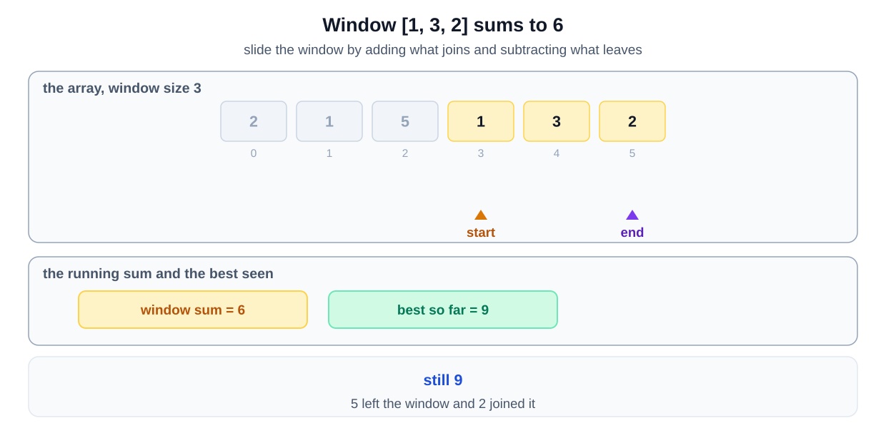
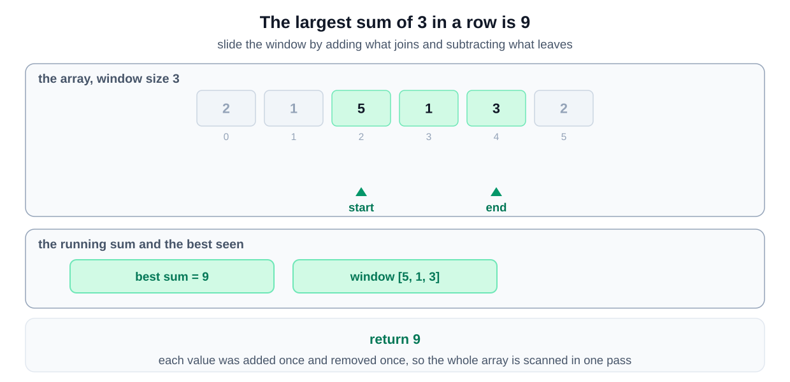

## Problem Statement
Given an array of positive numbers and a positive number 'k,' find the **maximum sum of any contiguous subarray of size 'k'**.

**Example 1:**
```
Input: arr = [2, 1, 5, 1, 3, 2], k=3 
Output: 9
Explanation: Subarray with maximum sum is [5, 1, 3].
```

**Example 2:**
```
Input: arr = [2, 3, 4, 1, 5], k=2 
Output: 7
Explanation: Subarray with maximum sum is [3, 4].
```


## Why this is a Sliding Window problem

| What the question says | The signal it matches |
|---|---|
| "maximum sum of any contiguous subarray of size 'k'" | the range is **contiguous**, and a **fixed size K** is given |
| "maximum sum" | you are asked for the **maximum** over all such ranges |
| adding up k elements again at every starting index | your first idea is **for each starting index, scan forward** |

A window of a set width, sliding one step at a time, is the [fixed size variant](/course-play/grokking-the-coding-interview/doc/introduction-to-sliding-window-pattern).

**The closest alternative.** Prefix Sum also answers this. Every window sum is a subtraction of two running totals. It costs `O(N)` memory for the prefix array.

A sliding window needs no extra memory. Add the number entering on the right and subtract the one leaving on the left. Prefix Sum is the better choice when the ranges are arbitrary and asked in any order, not when one window moves across the array.

## Solution
To solve this problem, we will use a brute force approach. The brute force method involves examining every possible subarray of size `k` and calculating their sums. We then keep track of the highest sum found. This approach is simple to understand and implement, making it a good choice for smaller arrays or when performance is not a concern. However, it may not be the most efficient for larger arrays due to its higher time complexity.

The brute force approach works by iterating through each possible starting index of a subarray of size `k`. For each starting index, we calculate the sum of the subarray by iterating through the next `k` elements. We update our maximum sum whenever we find a new subarray with a higher sum. While this method ensures we find the maximum sum, it involves a nested loop, leading to a higher computational cost.

### Step-by-Step Algorithm

1. **Initialize Variables**:
    - `maxSum` to store the maximum sum encountered, initially set to 0.
    - `windowSum` to store the sum of the current subarray of size `k`.

2. **Outer Loop**:
    - Iterate from the start of the array to `arr.Length - k`. This ensures we have enough elements left to form a subarray of size `k`.

3. **Reset `windowSum`**:
    - For each new starting index `i`, set `windowSum` to 0.

4. **Inner Loop**:
    - Iterate from the current starting index `i` to `i + k - 1`.
    - Add each element to `windowSum` to compute the sum of the current subarray.

5. **Update `maxSum`**:
    - After computing the sum of the current subarray, update `maxSum` if `windowSum` is greater.

6. **Return `maxSum`**:
    - After completing both loops, `maxSum` will contain the highest sum of any subarray of size `k`.

### Algorithm Walkthrough

## Code
Here is what our algorithm will look like:


## Complexity Analysis

### **Time Complexity**
- **Outer loop**: The outer loop runs for each possible starting index of a subarray of size `K`. The number of such subarrays is $N - K + 1$, where `N` is the length of the array. This means the outer loop runs approximately $O(N)$ times.

- **Inner loop**: For each iteration of the outer loop, the inner loop runs exactly `K` times to calculate the sum of the current subarray. So, for each outer loop iteration, we spend $O(K)$ time calculating the sum of the subarray.

- Therefore, the total time complexity is $O(N \times K)$ because for each subarray, we are doing $O(K)$ work to compute its sum.

**Overall time complexity**: $O(N \times K)$.

### **Space Complexity**
- **Additional variables**: The algorithm only uses a few extra variables, such as `maxSum` and `windowSum`, both of which require constant space. No additional data structures that depend on the input size are used.

**Overall space complexity**: $O(1)$.


Is it possible to find a better algorithm than this?

## A Better Approach

To solve this problem, we will use a sliding window technique. This approach allows us to maintain the sum of the current subarray of size K, and as we move through the array, we update this sum by subtracting the element that is no longer in the subarray and adding the next element in the array. This method is effective because it avoids the need to repeatedly sum elements for overlapping subarrays, thus reducing the time complexity to linear time, O(n). By keeping track of the maximum sum encountered, we ensure that we can efficiently find the solution.

The sliding window approach works well because it maintains a running sum of a fixed number of elements. This avoids the inefficiencies of recalculating sums for each subarray, which would be necessary if we were to use a brute force method. The efficiency and simplicity of updating the sum as we slide the window over the array make this approach optimal for this problem.

### Step-by-Step Algorithm

1. **Initialize Variables**:
    - `windowSum` to store the sum of the current window of size `k`.
    - `maxSum` to store the maximum sum encountered.
    - `windowStart` to mark the start of the current window.

2. **Iterate through the array**:
    - Use a `for` loop where `windowEnd` goes from `0` to the end of the array.

3. **Add the current element to `windowSum`**:
    - `windowSum += arr[windowEnd]`

4. **Check if we have hit the window size**:
    - If `windowEnd` is greater than or equal to `k-1`, perform the following steps:

5. **Update `maxSum`**:
    - Set `maxSum` to the greater of `maxSum` and `windowSum`: `maxSum = Math.Max(maxSum, windowSum)`

6. **Slide the window**:
    - Subtract the element at `windowStart` from `windowSum`: `windowSum -= arr[windowStart]`
    - Increment `windowStart` by 1 to slide the window: `windowStart++`

7. **Return `maxSum`**:
    - After the loop ends, `maxSum` will contain the maximum sum of any subarray of size `k`.

### Algorithm Walkthrough

Using the array `[2, 1, 5, 1, 3, 2]` and `K = 3`:

1. **Initialization**:
    - `windowSum = 0`
    - `maxSum = 0`
    - `windowStart = 0`

2. **Iteration**:
    - `windowEnd = 0`:
        - Add `arr[0]` (2) to `windowSum`: `windowSum = 2`
    - `windowEnd = 1`:
        - Add `arr[1]` (1) to `windowSum`: `windowSum = 3`
    - `windowEnd = 2`:
        - Add `arr[2]` (5) to `windowSum`: `windowSum = 8`
        - Since `windowEnd` is `>= k-1`:
            - Update `maxSum = Math.Max(0, 8) = 8`
            - Subtract `arr[0]` (2) from `windowSum`: `windowSum = 6`
            - Increment `windowStart`: `windowStart = 1`
    - `windowEnd = 3`:
        - Add `arr[3]` (1) to `windowSum`: `windowSum = 7`
        - Since `windowEnd` is `>= k-1`:
            - Update `maxSum = Math.Max(8, 7) = 8`
            - Subtract `arr[1]` (1) from `windowSum`: `windowSum = 6`
            - Increment `windowStart`: `windowStart = 2`
    - `windowEnd = 4`:
        - Add `arr[4]` (3) to `windowSum`: `windowSum = 9`
        - Since `windowEnd` is `>= k-1`:
            - Update `maxSum = Math.Max(8, 9) = 9`
            - Subtract `arr[2]` (5) from `windowSum`: `windowSum = 4`
            - Increment `windowStart`: `windowStart = 3`
    - `windowEnd = 5`:
        - Add `arr[5]` (2) to `windowSum`: `windowSum = 6`
        - Since `windowEnd` is `>= k-1`:
            - Update `maxSum = Math.Max(9, 6) = 9`
            - Subtract `arr[3]` (1) from `windowSum`: `windowSum = 5`
            - Increment `windowStart`: `windowStart = 4`

3. **Result**:
    - The final `maxSum` is 9, which is the maximum sum of any subarray of size `k = 3`.








## Code

## Complexity Analysis

### **Time Complexity**
- **Single pass**: The algorithm makes a single pass through the array using the sliding window technique. The loop runs for each element of the array, so the time complexity is $O(N)$, where `N` is the number of elements in the array.

- **Sliding window**: The sliding window allows the algorithm to efficiently maintain the sum of the current window. Instead of recalculating the sum for each subarray from scratch, the algorithm adds the new element entering the window and subtracts the old element leaving the window in constant time, $O(1)$. This optimization results in a linear time complexity.

**Overall time complexity**: $O(N)$.

### **Space Complexity**
- **Additional variables**: The algorithm uses a few extra variables, such as `windowSum`, `maxSum`, `windowStart`, and `windowEnd`. These variables require constant space, $O(1)$.

**Overall space complexity**: $O(1)$.

