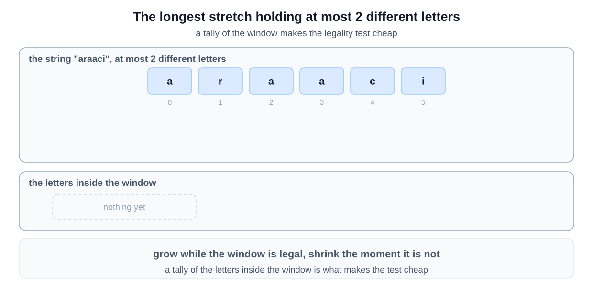
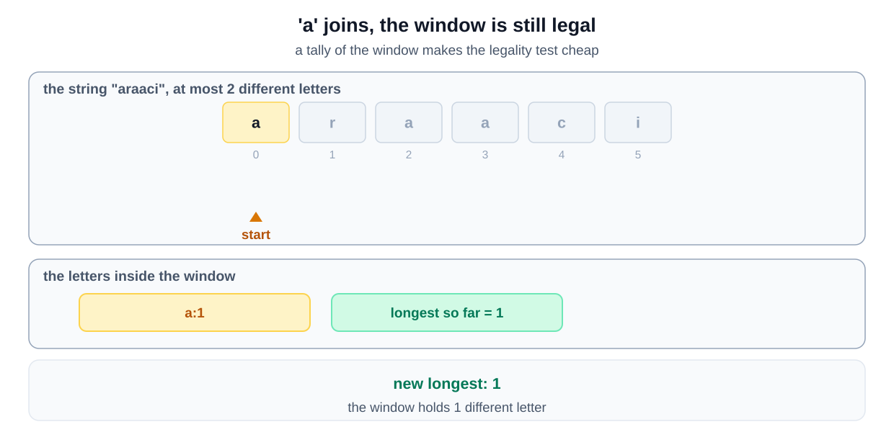
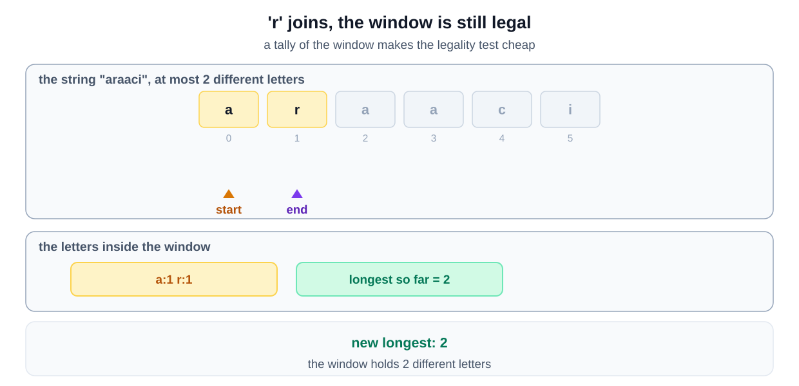
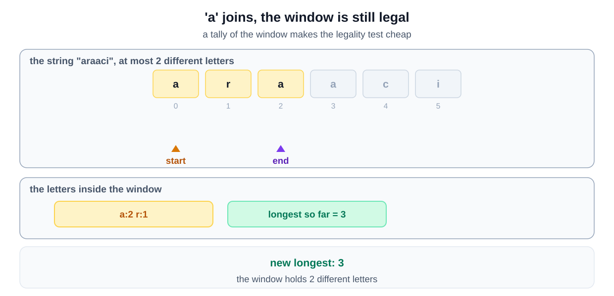
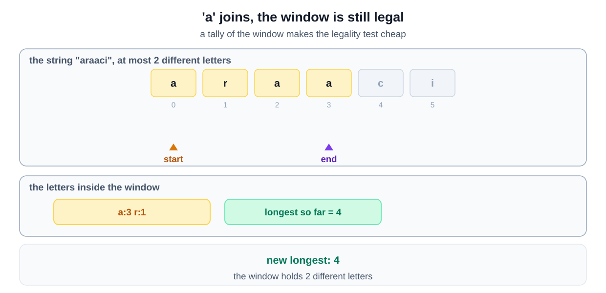
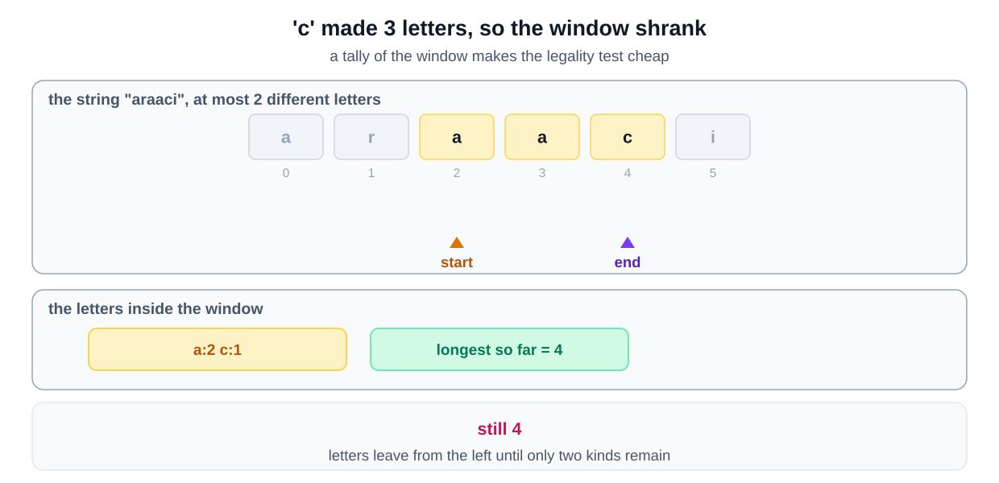
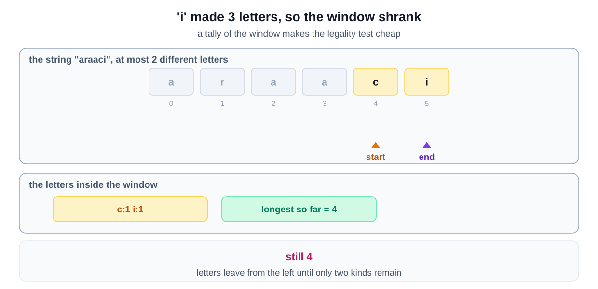
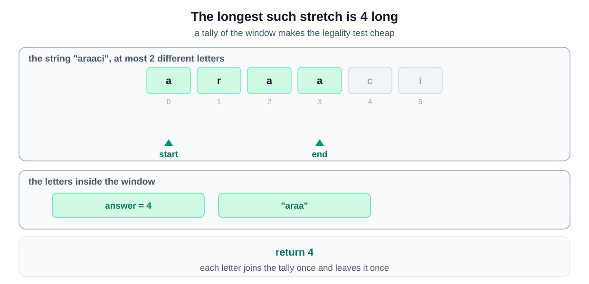

## **Problem Statement**
Given a string, find the length of the **longest substring** in it **with no more than K distinct characters**.

You can assume that K is less than or equal to the length of the given string.

**Example 1:**

```
Input: str="araaci", K=2  
Output: 4  
Explanation: The longest substring with no more than '2' distinct characters is "araa".
```

**Example 2:**
```
Input: str="araaci", K=1  
Output: 2  
Explanation: The longest substring with no more than '1' distinct characters is "aa".
```

**Example 3:**
```
Input: str="cbbebi", K=3  
Output: 5  
Explanation: The longest substrings with no more than '3' distinct characters are "cbbeb" & "bbebi".
```
**Constraints:**

- 1 <= str.length <= 5 * 10<sup>4</sup>
- `0 <= K <= 50`


## Why this is a Sliding Window problem

| What the question says | The signal it matches |
|---|---|
| "longest substring" | the range is **contiguous**, and you want the **longest** one |
| "with no more than K distinct characters" | a limit that a window can break and then repair by shrinking |
| checking every substring for its distinct count | your first idea is **for each starting index, scan forward** |

Extend on the right, and shrink from the left only while the rule is broken. That is the [grow to the largest legal window variant](/course-play/grokking-the-coding-interview/doc/introduction-to-sliding-window-pattern).

**The closest alternative.** Read the word "substring" carefully. A substring is contiguous, and that is what makes a window possible.

If the question said subsequence, characters could be skipped. No window would describe the answer, and it would become a Dynamic Programming question. That single word decides the pattern.

## **Solution**
To solve this problem, we can use a sliding window approach. The idea is to maintain a window that contains at most \( K \) distinct characters. We will expand the window by including one character at a time from the right, and once the window contains more than \( K \) distinct characters, we will shrink it from the left until it again contains \( K \) or fewer distinct characters. 

This approach is effective because it allows us to process the string in linear time, which is efficient for large inputs. By keeping track of the frequency of characters within the window using a hash map, we can efficiently manage the characters and ensure that the window always contains at most \( K \) distinct characters.

### Step-by-Step Algorithm

1. Initialize two pointers, `windowStart` and `windowEnd`, both set to 0.
2. Create a hash map to keep track of the frequency of characters within the current window.
3. Start a loop with `windowEnd` ranging from 0 to the length of the string:
   - Add the character at `windowEnd` to the hash map and update its frequency.
   - If the hash map contains more than \( K \) distinct characters:
     - Remove characters from the left (i.e., move `windowStart` to the right) until the hash map contains at most \( K \) distinct characters.
     - Decrease the frequency of the leftmost character and remove it from the hash map if its frequency becomes zero.
   - Update the maximum length of the substring found so far.
4. Return the maximum length.

### Algorithm Walkthrough









