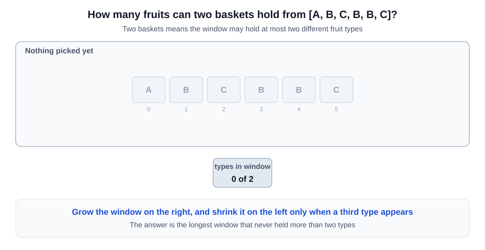
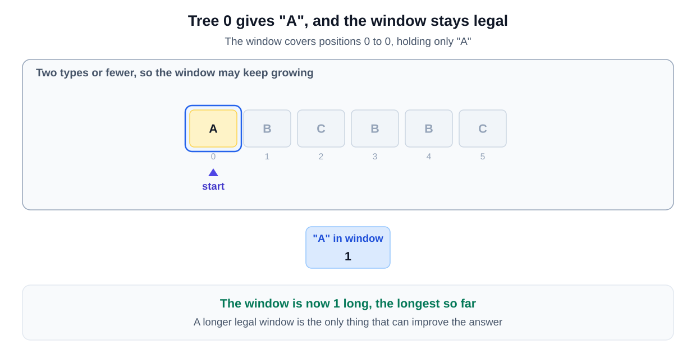
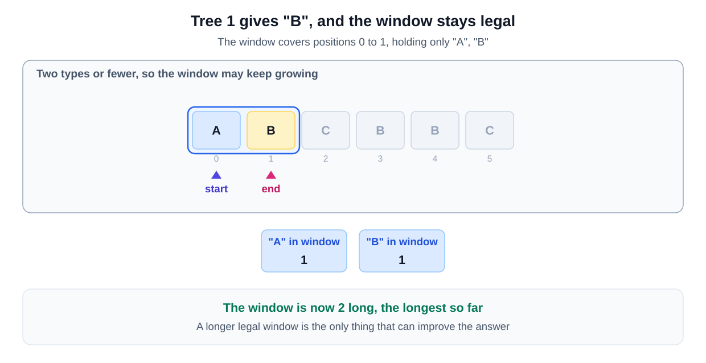
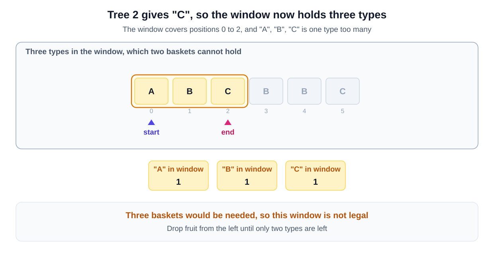
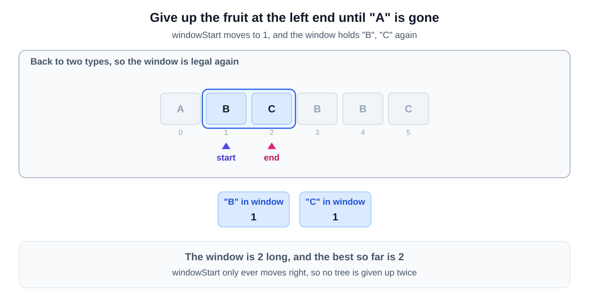
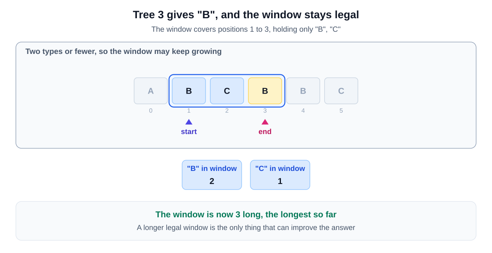
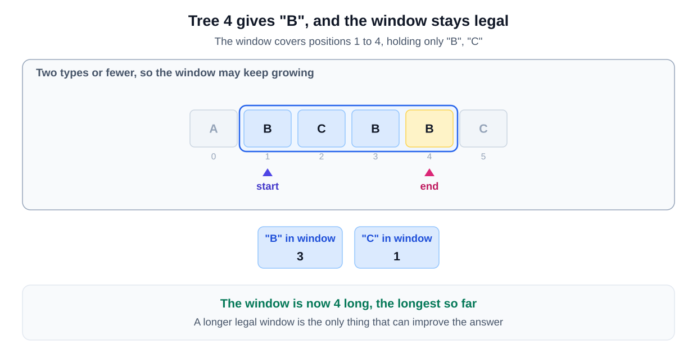
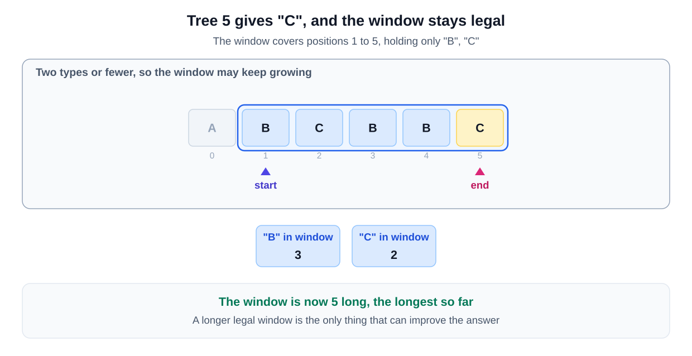

## Why this is a Sliding Window problem

| What the question says | The signal it matches |
|---|---|
| "you can't skip a tree once you have started" | the range is **contiguous**, stated as a rule about picking rather than as the word substring |
| "return the maximum number of fruits in both baskets" | you are asked for the **maximum** length of a legal range |
| "Each basket can have only one type of fruit" and there are two baskets | the limit is at most two distinct types, which shrinking can restore |

Extend while the run stays legal, shrink when a third type appears. That is the [grow to the largest legal window variant](/course-play/grokking-the-coding-interview/doc/introduction-to-sliding-window-pattern).

**The closest alternative.** There is no real alternative, once the story is removed. This is Longest Substring with K Distinct Characters with K fixed at 2, written as a farm.

The skill here is not a new technique. It is noticing that trees are characters, and baskets are the distinct limit. The phrase "can't skip a tree" is the word contiguous.

## **Solution**

We maintain a window of elements that meet a certain condition, in this case having no more than two types of fruit. We expand the window by adding elements from the right and contract it from the left when the condition is violated. This approach ensures we check all possible subarrays without starting from each element repeatedly, making it efficient.

This method works well because it continuously adjusts the window size based on the elements it encounters. By using a dictionary to keep track of the fruit counts within the window, we can efficiently manage and adjust the window size to find the maximum length subarray that satisfies the condition. The efficiency comes from the fact that each element is processed at most twice, once when added and once when removed from the window.

### Step-by-Step Algorithm

- Initialize two variables: `windowStart` to keep track of the starting index of the window and `maxLength` to store the maximum length of the subarray found.
- Create a dictionary `fruitFrequencyMap` to count the frequency of each fruit in the current window.
- Iterate over the array using a variable `windowEnd` which marks the end of the window.
  - Add the current fruit at `windowEnd` to the dictionary and update its count.
  - If the dictionary size exceeds two, it means there are more than two types of fruits in the window.
    - Shrink the window from the start by removing the fruit at `windowStart` and updating the dictionary.
    - If the count of the fruit at `windowStart` becomes zero, remove it from the dictionary.
    - Move `windowStart` to the right to shrink the window.
  - Update `maxLength` to be the maximum of its current value and the size of the current window (`windowEnd - windowStart + 1`).
- Return `maxLength` as the result.

### Algorithm Walkthrough

Let's trace the window on `['A', 'B', 'C', 'B', 'B', 'C']`, the second example. Move through the steps one at a time:

.svg)