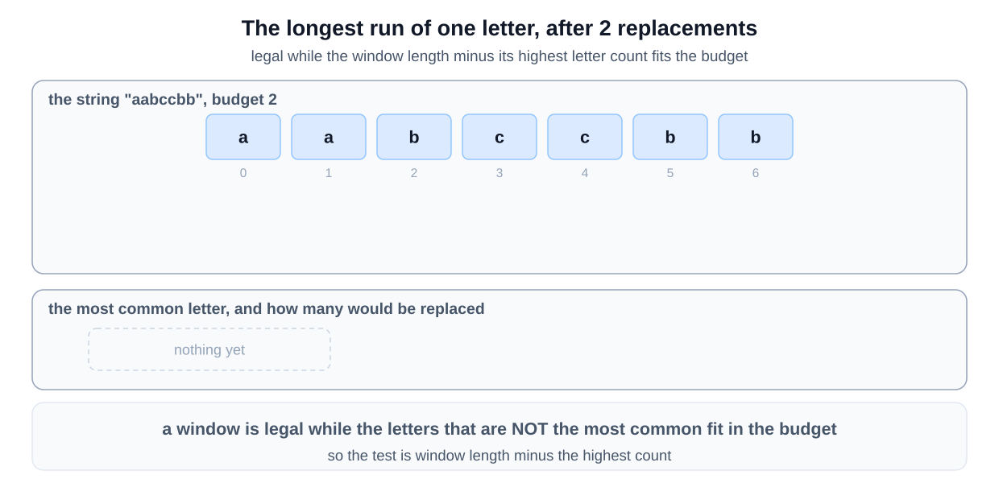
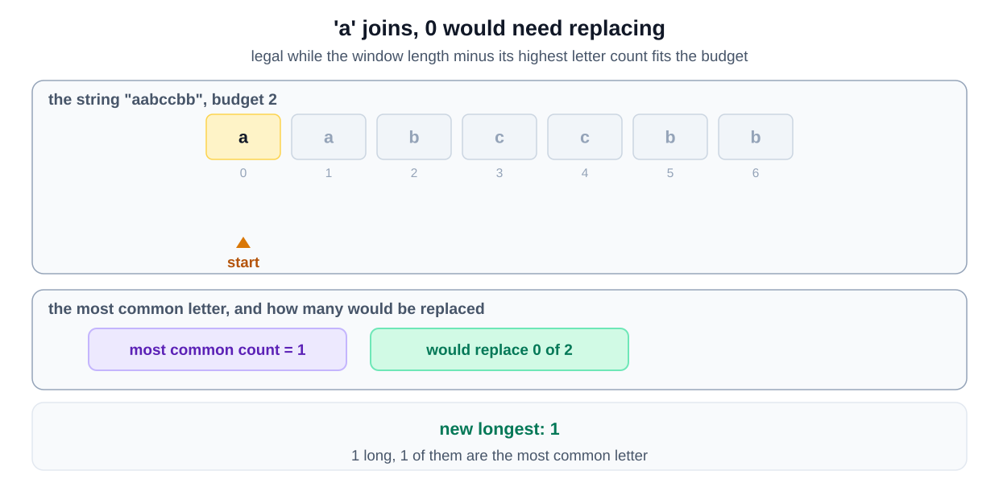
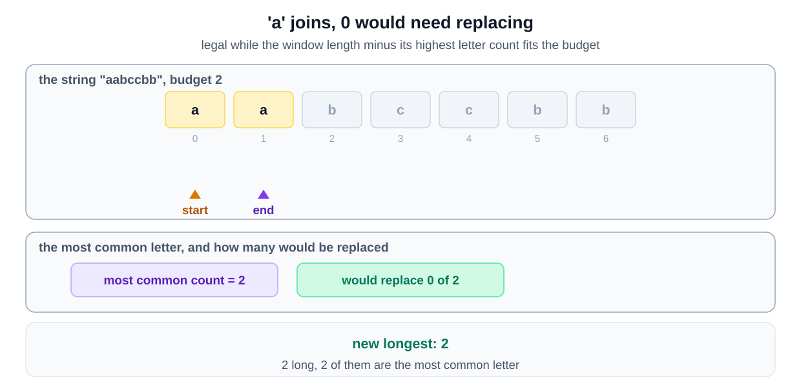
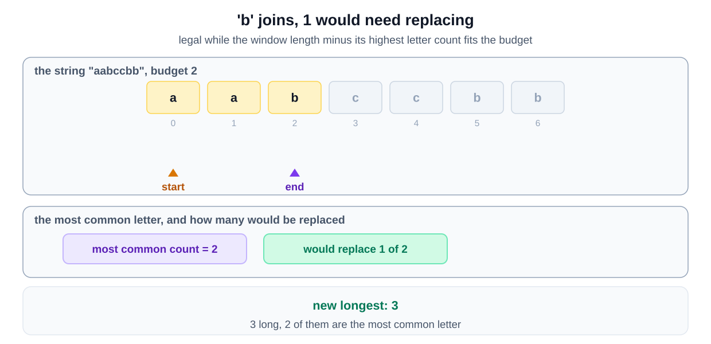
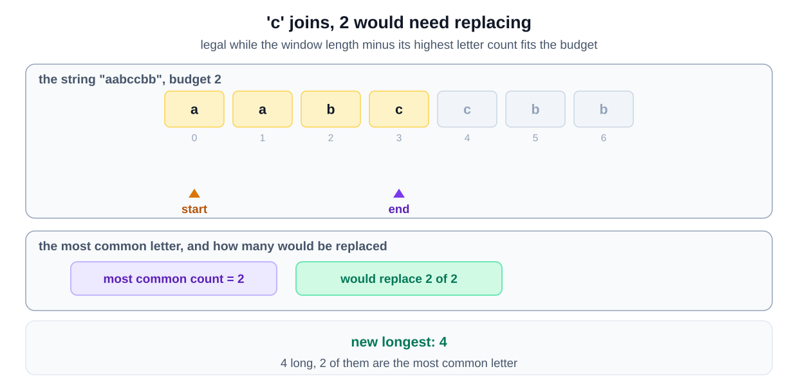
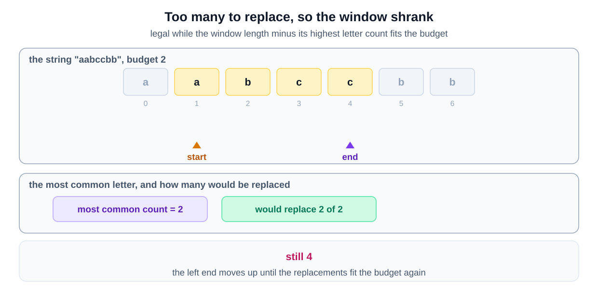
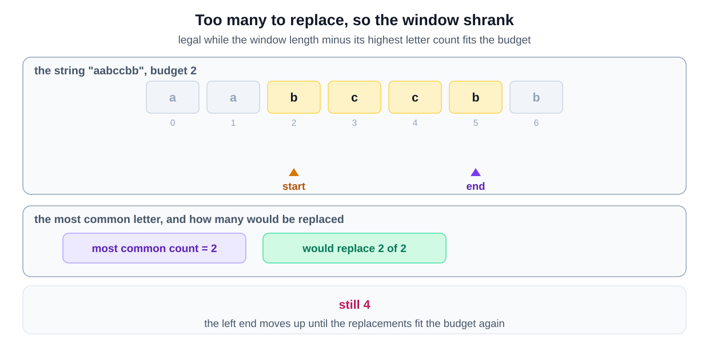
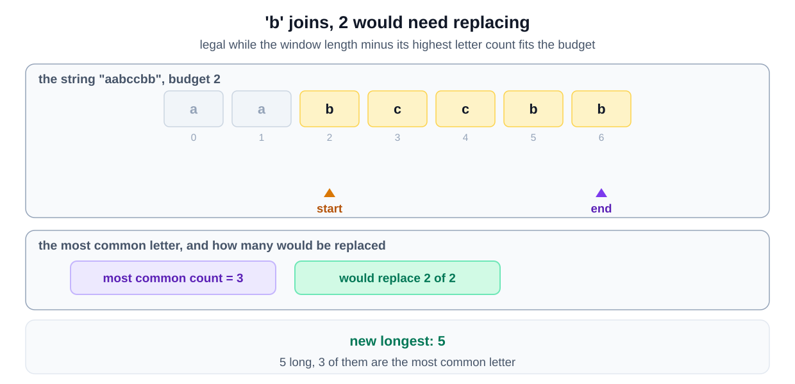
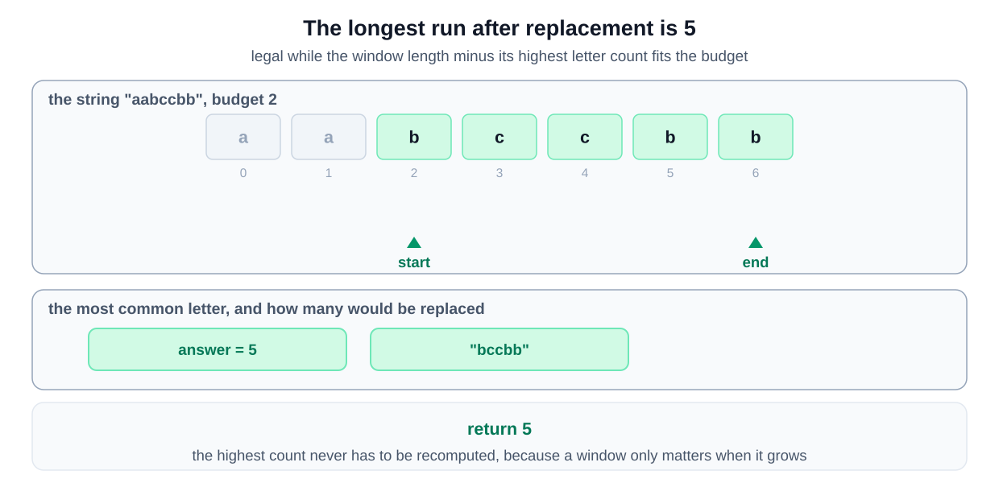

## Why this is a Sliding Window problem

| What the question says | The signal it matches |
|---|---|
| "length of the longest substring having the same letters" | the range is **contiguous**, and you want the **longest** one |
| "replace no more than" k "letters" | a budget that a window can overspend and then repair by shrinking |
| testing every substring to see how many replacements it needs | your first idea is **for each starting index, scan forward** |

Extend while the budget holds, shrink when it is exceeded, which is the [grow to the largest legal window variant](/course-play/grokking-the-coding-interview/doc/introduction-to-sliding-window-pattern).

**The closest alternative.** The pattern is clear here. The condition is the awkward part.

A window is legal when its length minus the count of its most frequent letter is at most k. Every other letter has to be replaced. Keeping that count correct as the window moves is the hard part. That is why the section on frequency maps in the introduction matters here.

## Solution

To solve this problem, we can use a sliding window technique. The idea is to maintain a window that can contain up to `k` characters that are different from the most frequent character in the current window. By doing so, we maximize the length of the window while keeping the number of changes within the allowed limit. This approach works because the window will only shrink when the number of characters that need to be changed exceeds `k`. 

The sliding window approach is efficient because it only requires a single pass through the string, making it suitable for handling large input sizes. Additionally, it uses a hashmap to keep track of the frequency of characters in the current window, ensuring that we can quickly determine the most frequent character. This combination of techniques ensures that the solution is both time and space efficient.

### Step-by-step Algorithm
1. **Initialize Variables**
   - Start a window at the beginning of the string.
   - Set `maxLength` to 0 to keep track of the longest valid substring.
   - Use `maxRepeatLetterCount` to store the count of the most frequent character in the current window.
   - Use a HashMap `letterFrequencyMap` to store the frequency of each character in the current window.

2. **Expand the Window**
   - Iterate through the string using a loop with `windowEnd` ranging from 0 to the length of the string.
   - Add the character at `windowEnd` to the `letterFrequencyMap` and update its frequency.
   - Update `maxRepeatLetterCount` to be the maximum frequency of any character in the current window.

3. **Shrink the Window if Necessary**
   - If the number of characters that need to be replaced (`windowEnd - windowStart + 1 - maxRepeatLetterCount`) exceeds `k`, shrink the window from the left by incrementing `windowStart`.
   - Adjust the frequency of the character that is left out of the window.

4. **Update the Maximum Length**
   - Calculate the current window size and update `maxLength` if the current window size is larger.

5. **Return the Result**
   - After the loop, `maxLength` will hold the length of the longest substring where up to `k` characters can be replaced to make all characters the same.

### Algorithm Walkthrough

