## Why this is a Sliding Window problem

| What the question says | The signal it matches |
|---|---|
| "length of the longest contiguous subarray having all 1s" | the range is **contiguous**, and you want the **longest** one |
| "replace no more than" k "0s with 1s" | a budget that shrinking can repair |
| testing every subarray for how many zeros it holds | your first idea is **for each starting index, scan forward** |

Extend while the budget holds, shrink when it is exceeded. That is the [grow to the largest legal window variant](/course-play/grokking-the-coding-interview/doc/introduction-to-sliding-window-pattern).

**The closest alternative.** This is the previous problem with an alphabet of two. There the window tracked the most frequent letter among 26.

Here there are only 0s and 1s. The most frequent value is the count of 1s. The window is legal while its length minus that count is at most k. Recognizing it as the same problem is faster than deriving it again.

## **Solution**

This is Longest Substring with same Letters after Replacement with one difference. Here we only have two characters, 1s and 0s, in the input array.

Following a similar approach, we'll iterate through the array to add one number at a time in the window. We'll also keep track of the maximum number of repeating 1s in the current window (let's call it `maxOnesCount`). So at any time, we know that we can have a window with 1s repeating `maxOnesCount` time, so we should try to replace the remaining 0s. If we have more than `k` remaining 0s, we should shrink the window as we are not allowed to replace more than `k` 0s.

### Step-by-Step Algorithm

- Initialize `windowStart` to 0, `maxLength` to 0, and `maxOnesCount` to 0.
- Iterate over the array using `windowEnd` from 0 to the end of the array.
  - If the current element is 1, increment `maxOnesCount`.
  - Calculate the current window size as `windowEnd - windowStart + 1`.
  - If the number of 0s in the current window (`windowEnd - windowStart + 1 - maxOnesCount`) is greater than `k`, shrink the window from the start.
    - If the element at `windowStart` is 1, decrement `maxOnesCount`.
    - Increment `windowStart`.
  - Update `maxLength` to be the maximum of `maxLength` and the current window size.
- Return `maxLength` as the length of the longest subarray.

### Algorithm Walkthrough

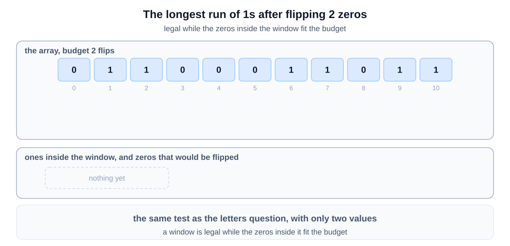
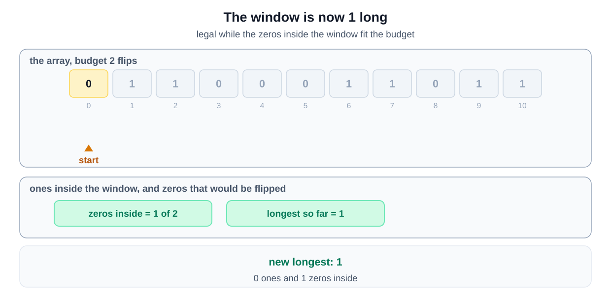
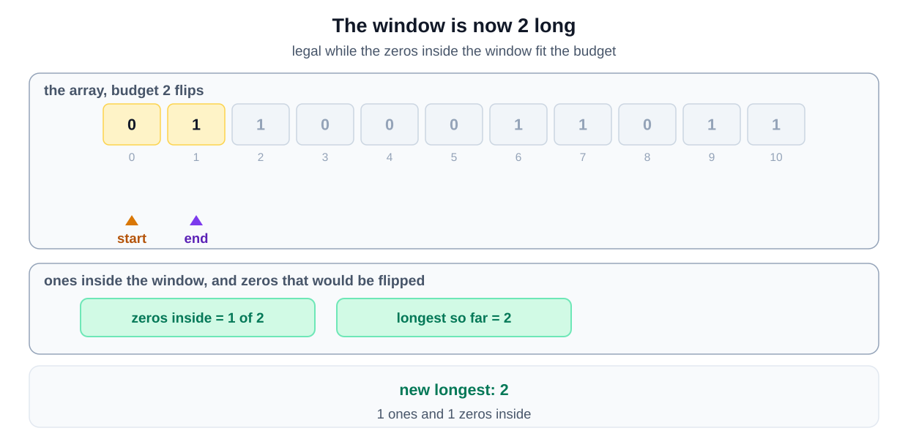
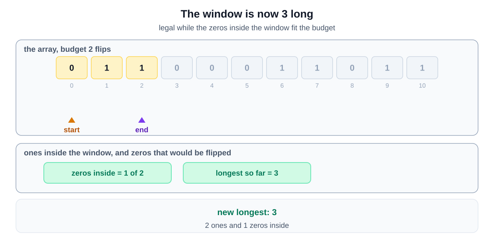
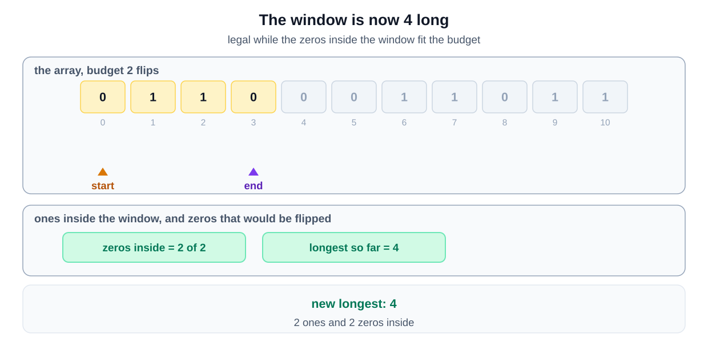
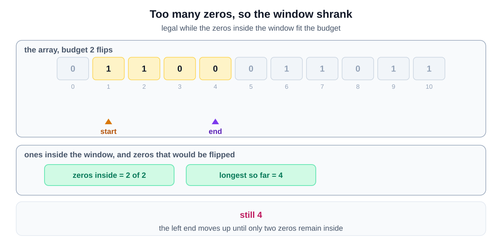
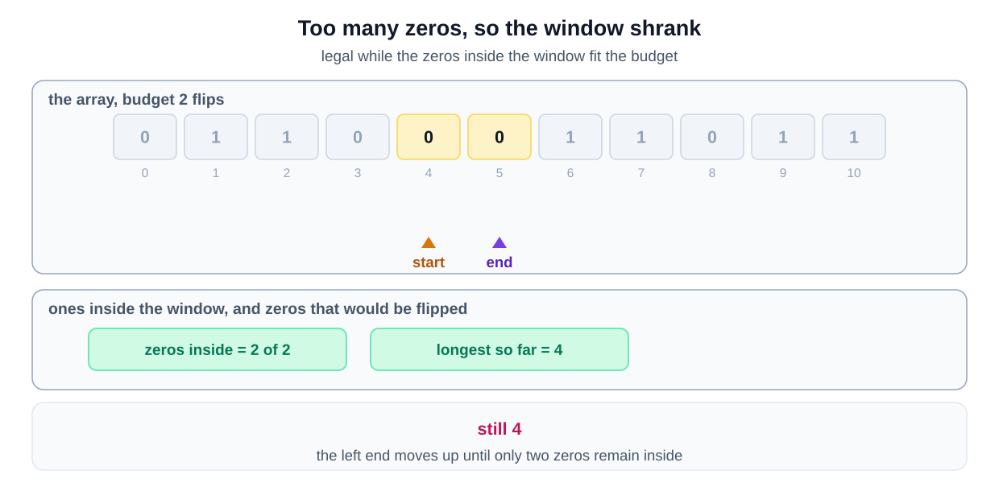
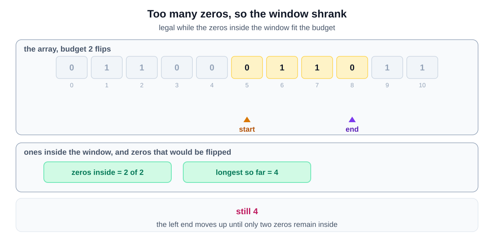
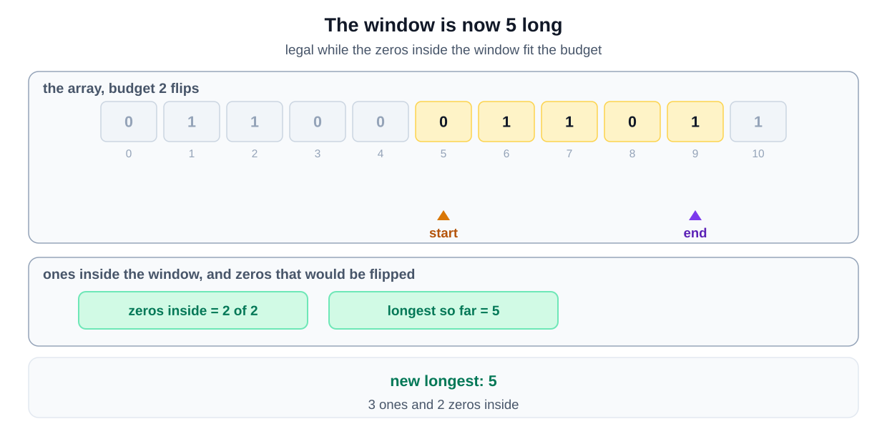
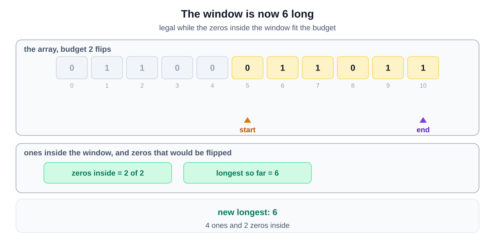
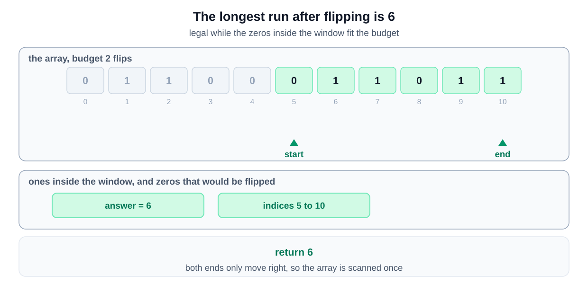
