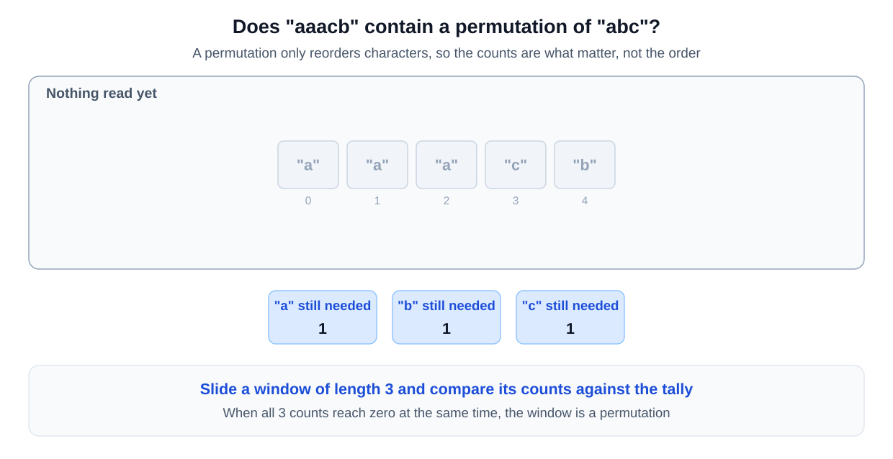
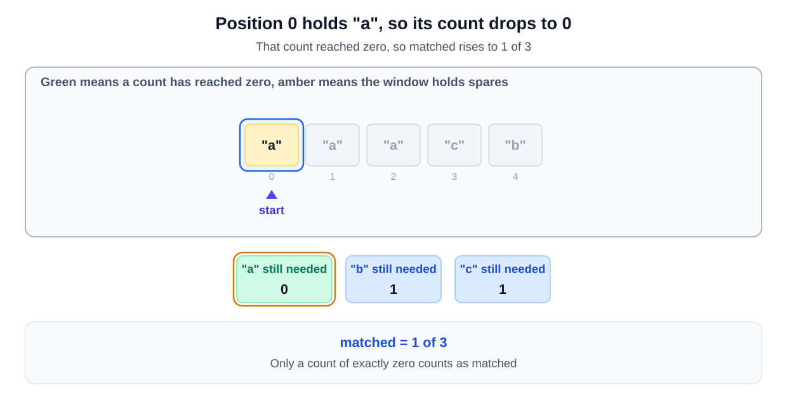
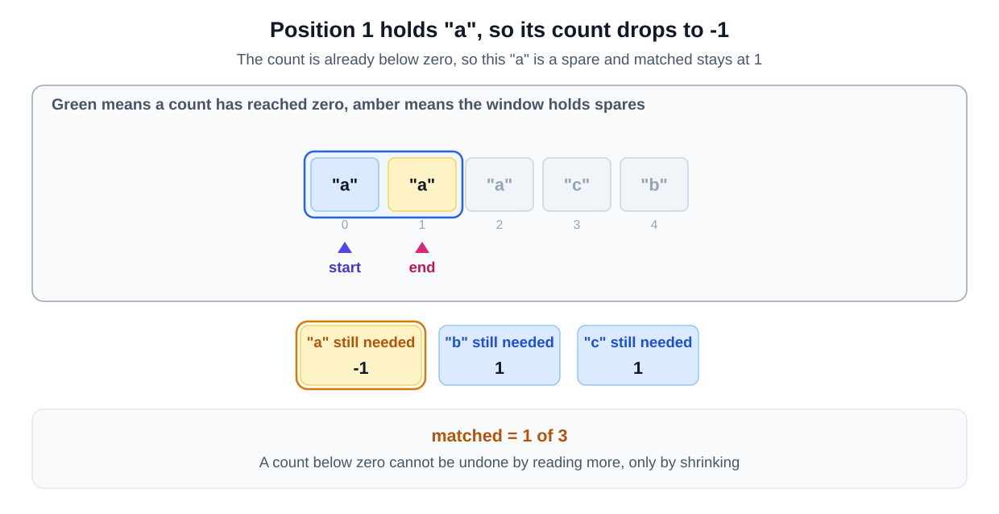
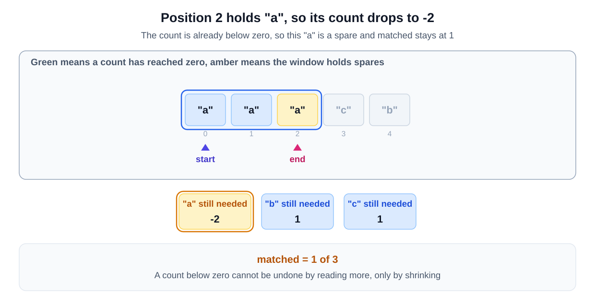
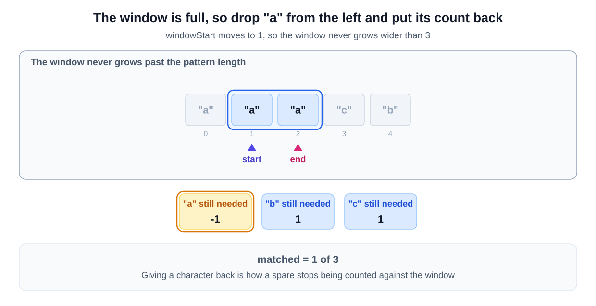
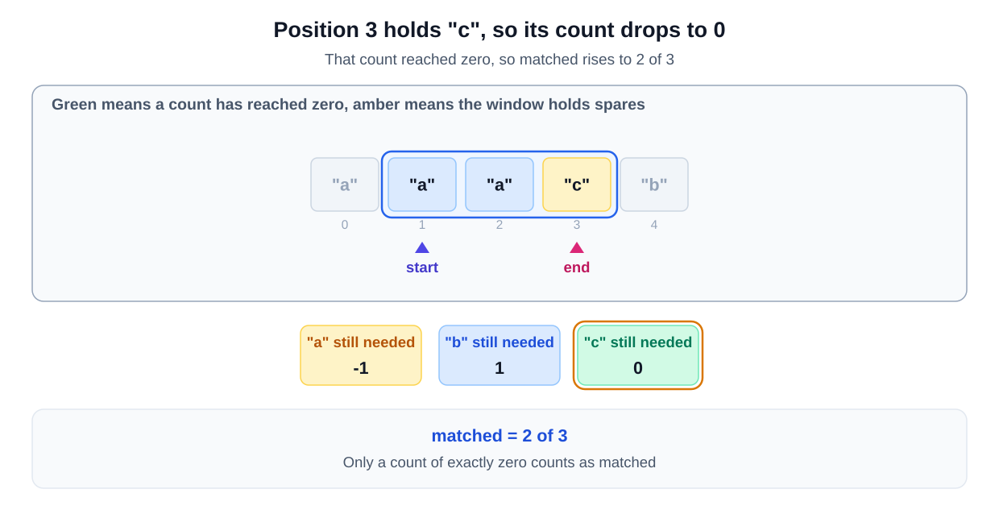
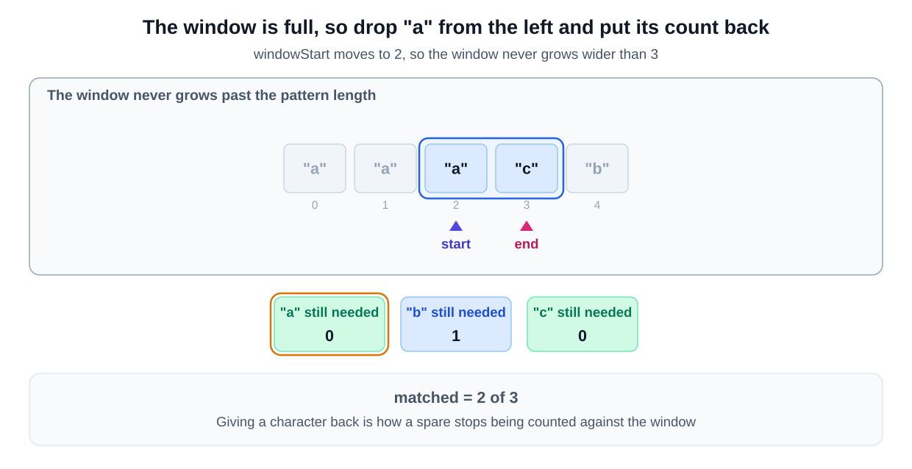
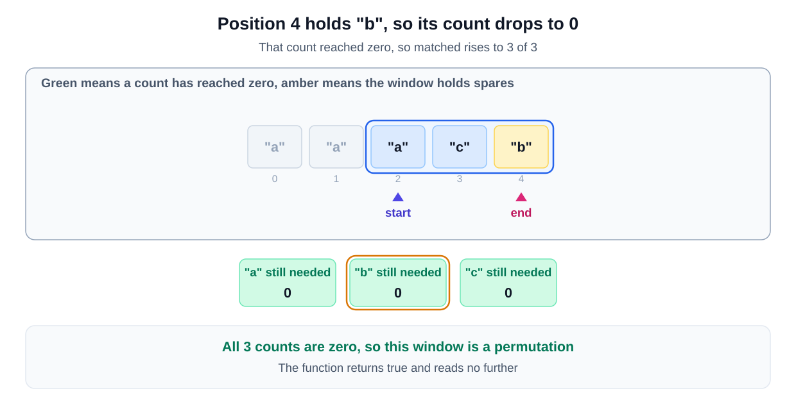
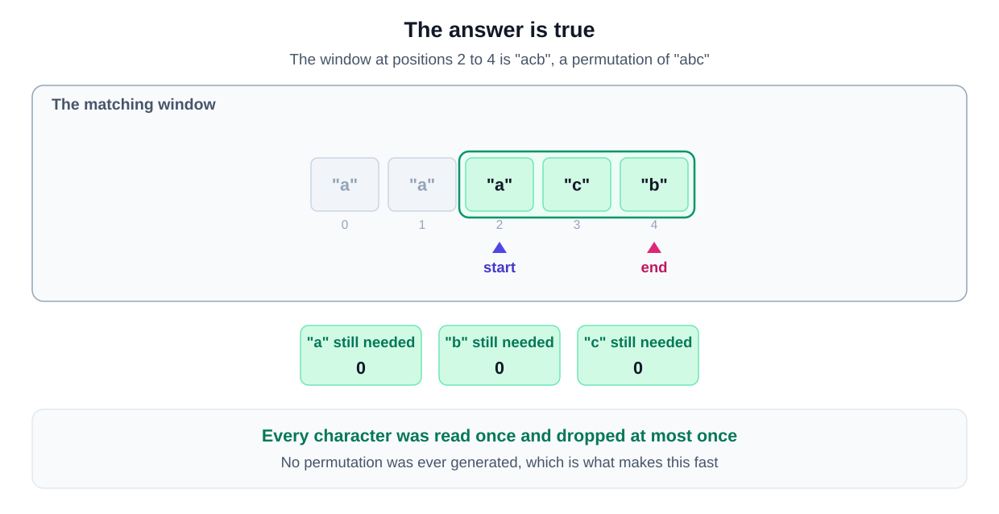

## Why this is a Sliding Window problem

| What the question says | The signal it matches |
|---|---|
| "the string contains any permutation of the pattern" | a permutation has the same length as the pattern, so the range is **contiguous** with a **fixed size** |
| a permutation is "the re-arranging of the characters of the string" | order does not matter, so the test is a comparison of character counts |
| checking every substring of the pattern's length | your first idea is **for each starting index, scan forward** |

A fixed window whose contents are compared against a tally of the pattern is the [match a frequency map variant](/course-play/grokking-the-coding-interview/doc/introduction-to-sliding-window-pattern).

**The closest alternative.** The word permutation suggests generating them, which is Subsets or Backtracking. The question even notes that "If a string has 'n' distinct characters" there are factorially many of them.

Generating them is the trap. A permutation only reorders characters, so the count of each character never changes. Two equal counts settle the question without producing a single arrangement.
## **Solution**

To solve this problem, we use a sliding window technique combined with a hashmap to keep track of character frequencies. The sliding window allows us to check each substring of the input string efficiently. The hashmap stores the count of each character in the pattern. As we slide the window over the string, we compare the character counts of the current window with those in the hashmap. This approach ensures that we only check substrings that are the same length as the pattern, which makes it very efficient.

The reason this approach is effective is due to its linear time complexity. Instead of generating all possible substrings, we slide a window of fixed size across the string and update our counts dynamically. This reduces the number of comparisons and allows us to quickly determine if a permutation of the pattern exists in the string. It is the most efficient approach as it combines the benefits of the sliding window and hashmap for constant time lookups and updates.

### Step-by-step Algorithm

- **Initialization:**
  - Create a hashmap to store the frequency of each character in the pattern.
  - Initialize the `windowStart` pointer and `matchedCount` to 0.

- **Sliding Window Iterations:**
  - For each character in the string (using `windowEnd` as the end pointer):
    - Check if the character is in the pattern's frequency map.
    - If it is, decrement its count in the map.
    - If the character's count in the map reaches 0, increment the matched count.
    - If the size of the window exceeds the pattern length:
      - Remove the leftmost character (at `windowStart`) from the window.
      - If the leftmost character is in the pattern's frequency map:
        - If its count was 0, decrement the matched count.
        - Increment the character's count back in the map.
    - Check if the matched count equals the number of unique characters in the pattern:
      - If it does, return `true`.

### Algorithm Walkthrough

Let's trace the window on `str = "aaacb"` and `pattern = "abc"`. Move through the steps one at a time:

