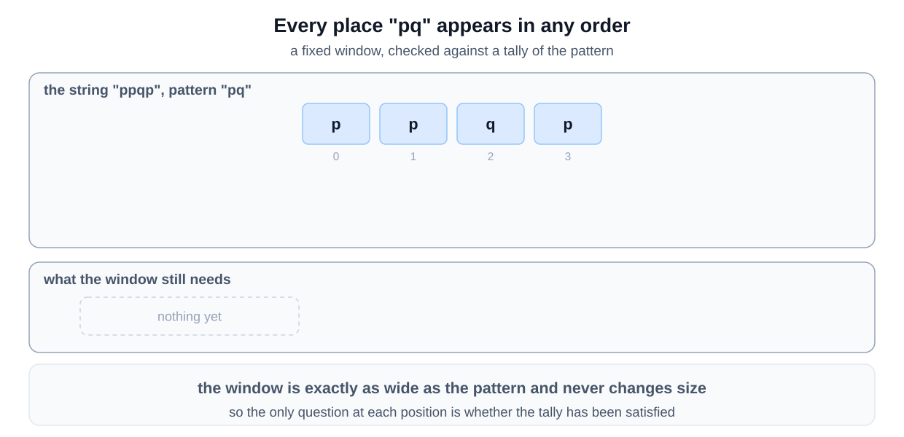
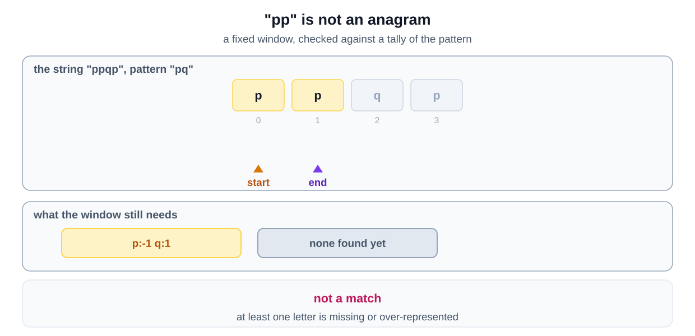
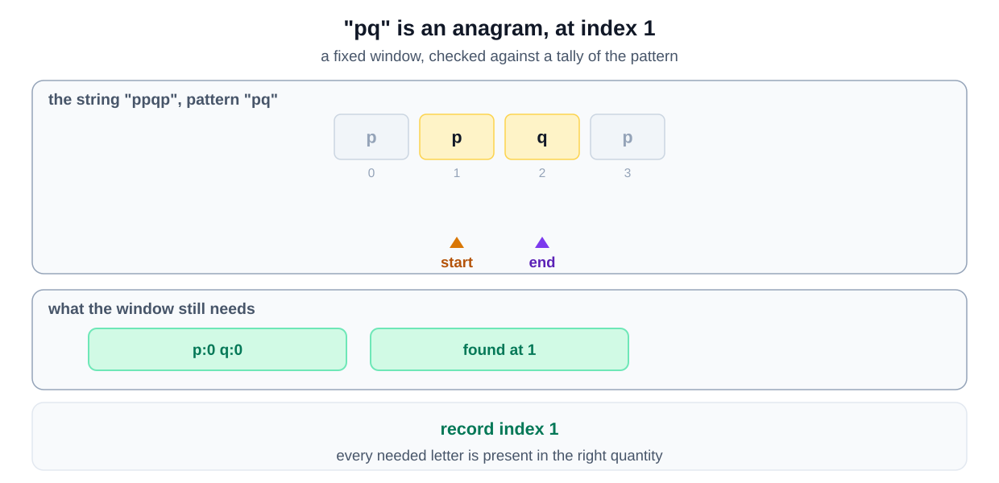
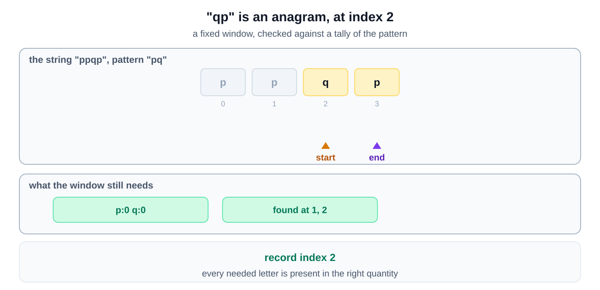
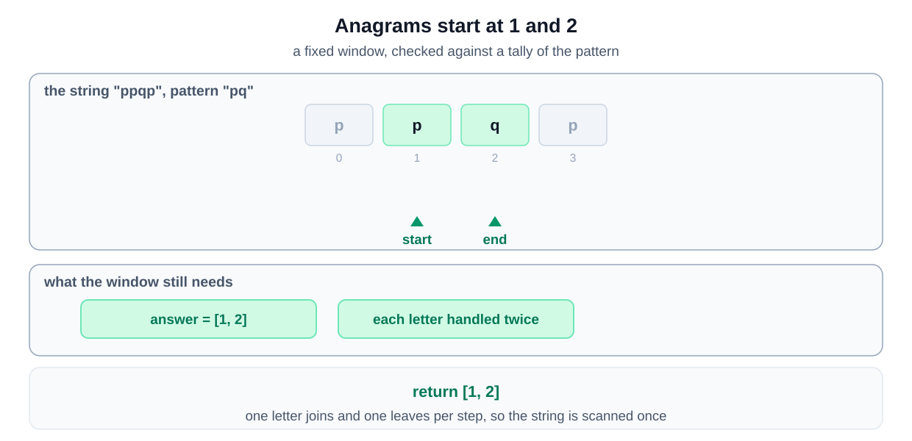

## Why this is a Sliding Window problem

| What the question says | The signal it matches |
|---|---|
| "find all anagrams of the pattern in the given string" | every anagram has the pattern's length, so the range is **contiguous** with a **fixed size** |
| "Every anagram is a permutation of a string" | order does not matter, so character counts decide a match |
| "return a list of starting indices" | every position must be tested, so one pass over all windows |

A fixed window compared against a tally of the pattern is the [match a frequency map variant](/course-play/grokking-the-coding-interview/doc/introduction-to-sliding-window-pattern).

**The closest alternative.** This is Permutation in a String with one change. It reports every match instead of stopping at the first. That removes the early exit, so the window always runs to the end of the string.

The counting argument that avoids generating permutations is the same. That is why this is not a Backtracking problem.

## Solution
To solve this problem, we use a sliding window approach along with a frequency map to keep track of character counts. By moving the window across the string, we can compare the current window's characters with the pattern's characters. 

This method is efficient because it allows us to check each possible window without repeatedly recalculating character counts from scratch. The sliding window approach is chosen because it ensures that each character in the string is processed only once, making the algorithm time-efficient. Moreover, using a hash map to store character frequencies helps quickly check if a window matches the pattern.

### Step-by-Step Algorithm

1. **Initialize Variables**:
   - Create a `windowStart` to mark the start of the sliding window.
   - Create a `matched` variable to track the number of characters matched with the pattern.
   - Create a `charFrequencyMap` to store the frequency of each character in the pattern.
   - Create a `resultIndices` list to store the starting indices of the anagrams found.

2. **Build Character Frequency Map**:
   - Loop through each character in the pattern and update `charFrequencyMap` with the count of each character.

3. **Slide the Window**:
   - Loop through the string with `windowEnd` marking the end of the sliding window.
   - Check if the current character at `windowEnd` is in the `charFrequencyMap`.
     - If it is, decrement its frequency in the map.
     - If the frequency becomes zero, increment the `matched` variable.

4. **Check for Anagram**:
   - If `matched` equals the size of `charFrequencyMap`, it means an anagram is found. Add `windowStart` to `resultIndices`.

5. **Shrink the Window**:
   - If the window size exceeds the pattern length, move the `windowStart` to the right.
   - Restore the frequency of the character at `windowStart` in `charFrequencyMap`.
   - If the restored frequency was zero, decrement the `matched` variable.

### Algorithm Walkthrough

