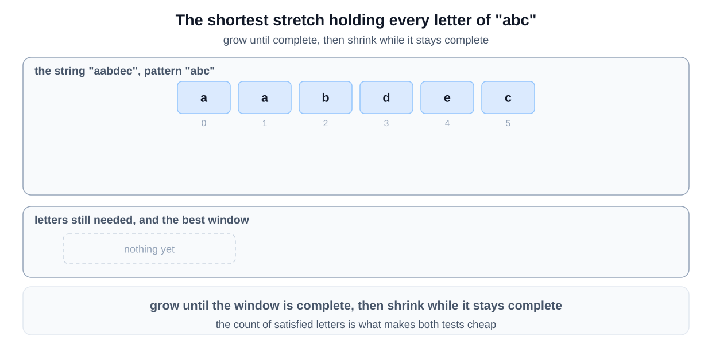
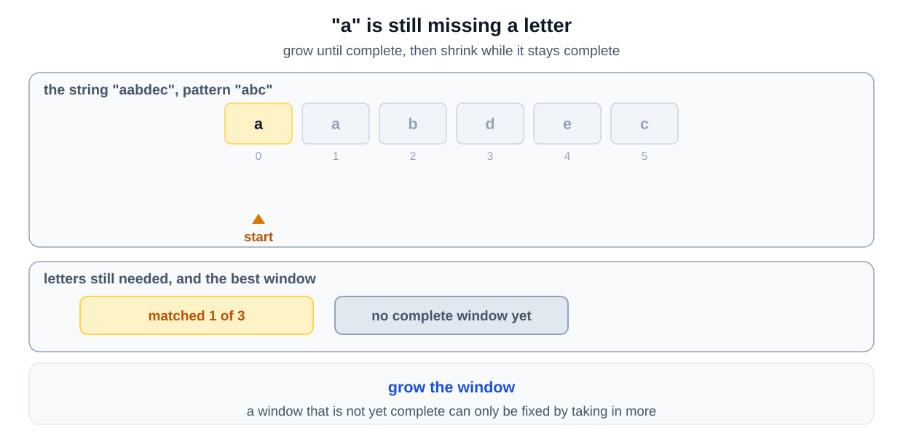
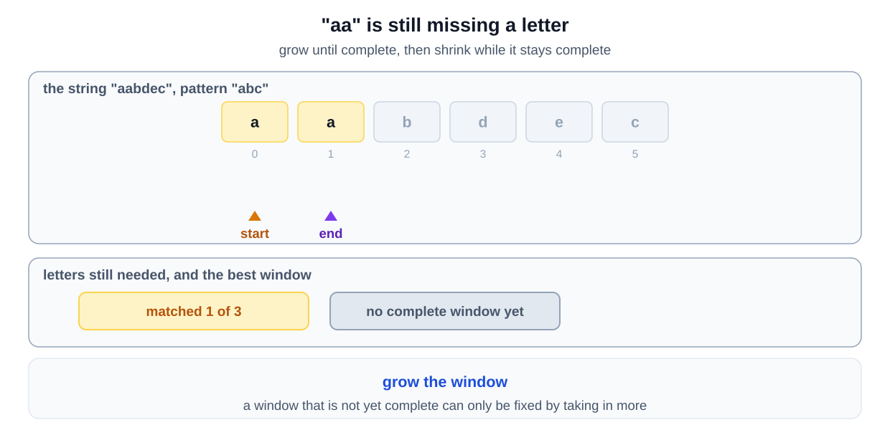
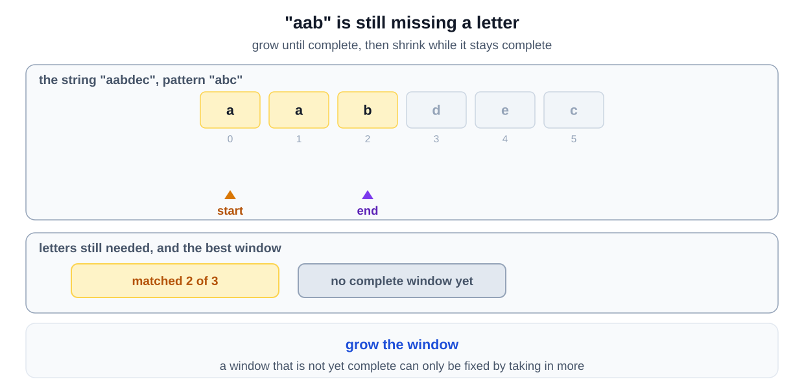
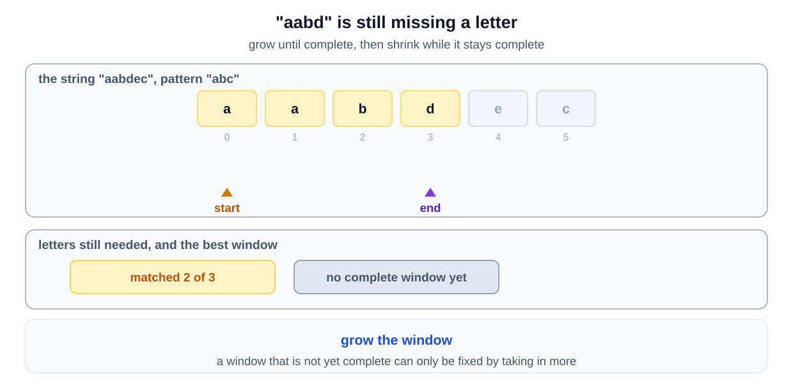
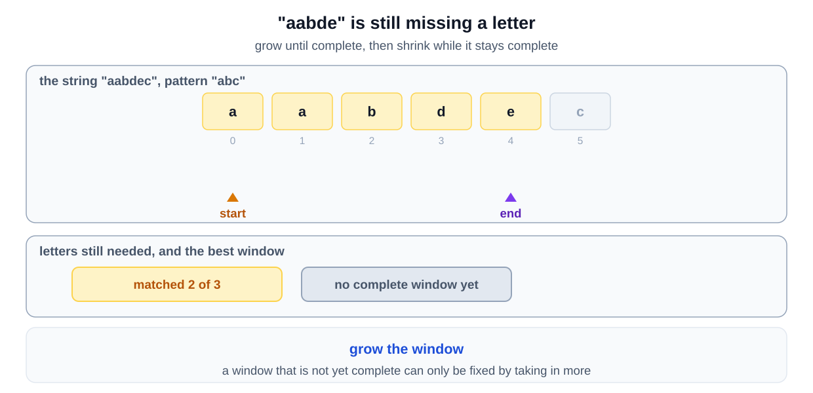
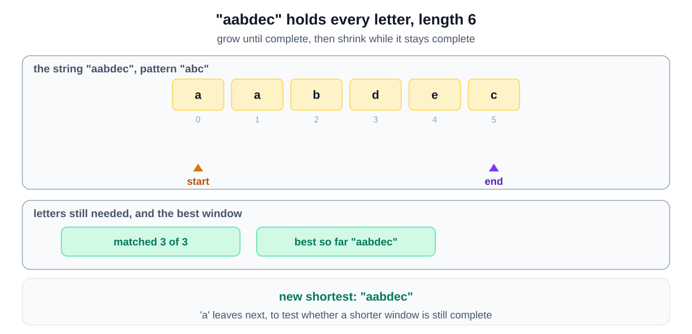
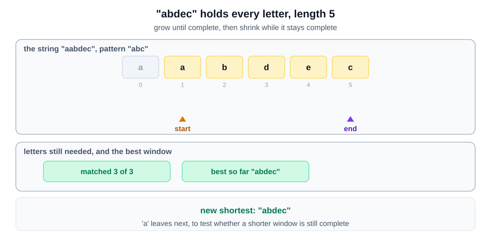
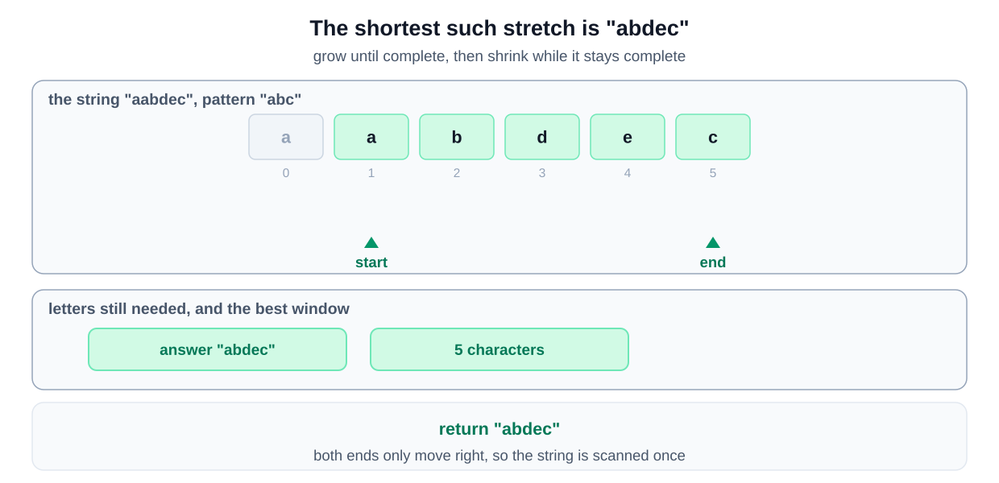

## Why this is a Sliding Window problem

| What the question says | The signal it matches |
|---|---|
| "find the smallest substring in the given string" | the range is **contiguous**, and you want the **shortest** one |
| which has "all the character occurrences of the given pattern" | a requirement a window can satisfy, then be trimmed against |
| testing every substring for whether it covers the pattern | your first idea is **for each starting index, scan forward** |

Grow until the window covers the pattern, then pull the left edge in while it still does. That is the [shrink to the smallest legal window variant](/course-play/grokking-the-coding-interview/doc/introduction-to-sliding-window-pattern).

**The closest alternative.** The anagram problems are the closest, because all three compare character counts. The difference is the window length.

An anagram window is exactly the pattern's length and never changes. Here the window may hold extra characters. The first example shows a three character pattern covered by a five character substring, so the length is discovered rather than known.
## Solution

To solve this problem, we use the sliding window technique. This approach helps us dynamically adjust the range of the substring we're considering. We start with two pointers, one at the beginning and another that expands to include new characters. As we move the right pointer to include characters, we check if the current window contains all the characters from `pattern` in the required frequency. Once it does, we try to shrink the window from the left to find the smallest possible window. This method is efficient because it avoids redundant calculations by reusing information from the previous state.

This approach is effective because it ensures that each character in `s` is processed at most twice (once by each pointer), resulting in a linear time complexity relative to the length of `s`. The space complexity is manageable, as we only store the frequency of characters in a hash map. This guarantees that the solution is both time and space efficient.

### Step-by-step Algorithm
1. **Initialize Variables:**
   - Create a hash map to store the frequency of characters in `pattern`.
   - Initialize variables: `windowStart` to track the start of the window, `minLength` to track the minimum window size, `matched` to count matched characters, and `subStrStart` to remember the start index of the smallest window.

2. **Expand the Window:**
   - Iterate through `s` with `windowEnd`.
   - For each character at `windowEnd`, check if it is in the hash map. If yes, decrement its frequency in the map.
   - If the character's frequency in the map is zero or more, increment the `matched` count.

3. **Shrink the Window:**
   - While `matched` equals the length of `pattern`, it means the current window contains all characters of `pattern`.
   - Update the `minLength` and `subStrStart` if the current window size is smaller than the previous smallest window.
   - Move the `windowStart` to the right to shrink the window. If the character at `windowStart` is in the hash map, increase its frequency in the map. If its frequency becomes zero, decrement the `matched` count.

4. **Return Result:**
   - After processing all characters, if `minLength` is greater than the length of `s`, return an empty string. Otherwise, return the substring starting at `subStrStart` with the length of `minLength`.

### Algorithm Walkthrough

