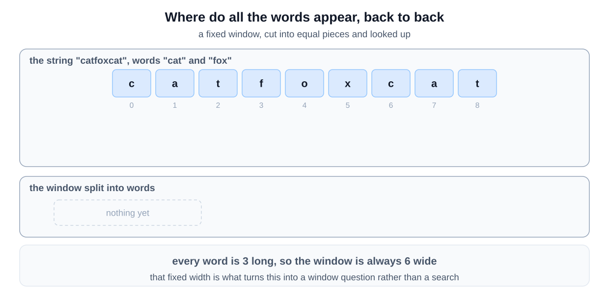
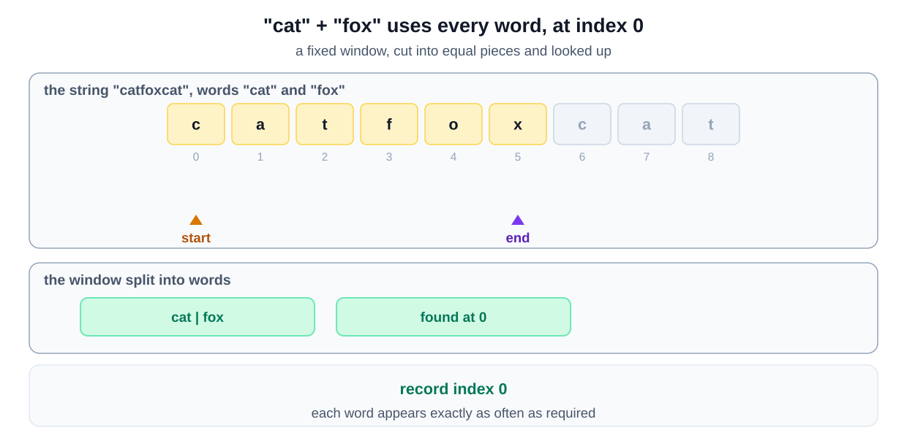
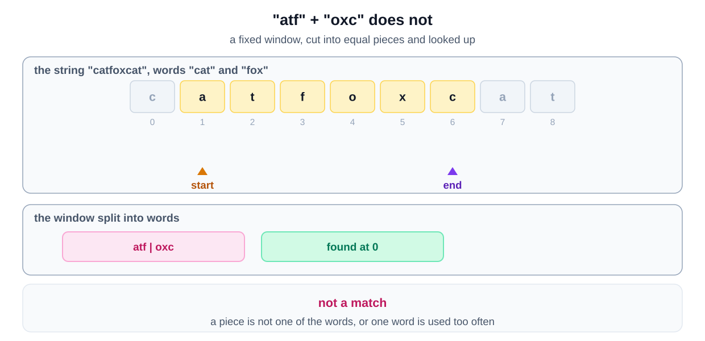
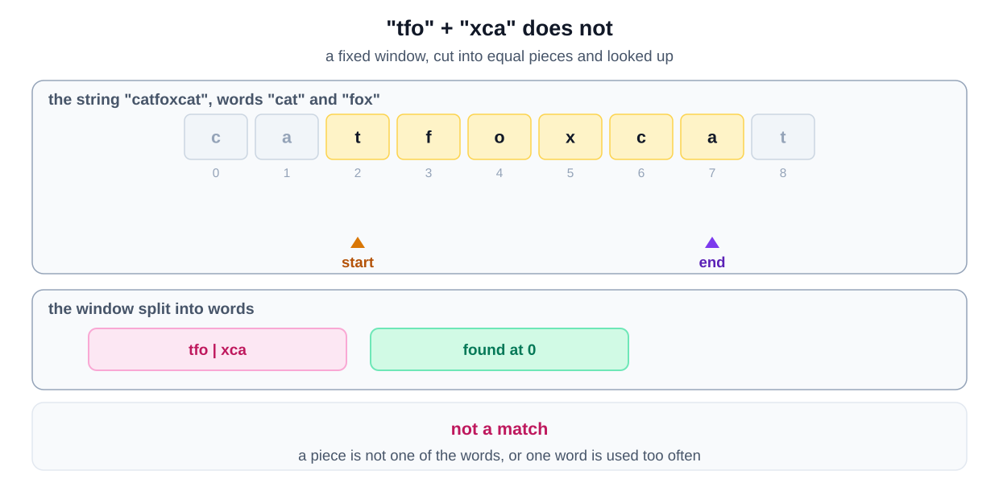
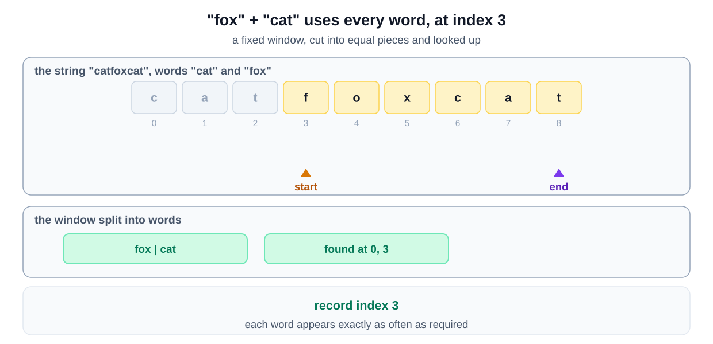
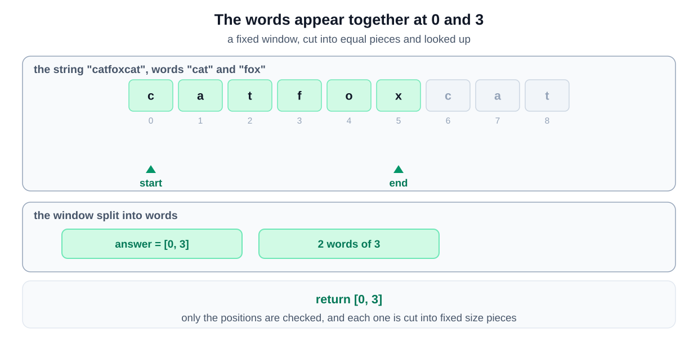

## Why this is a Sliding Window problem

| What the question says | The signal it matches |
|---|---|
| "all words have the same length" | every valid stretch has one known total length, so the range is **contiguous** with a **fixed size** |
| a match uses "any permutation of" the words, "each used exactly once" | order does not matter, so the test is a tally, here of whole words |
| "Return all starting indices" | every position must be checked |

A fixed window whose word counts are matched against the required ones is the [match a frequency map variant](/course-play/grokking-the-coding-interview/doc/introduction-to-sliding-window-pattern).

**The closest alternative.** Permutation appears again, and generating the orderings is again the trap. This is String Anagrams with the alphabet changed from characters to words.

That is why all words having the same length matters so much. Without it the window would have no fixed length, and none of this would work.

## Approach 1: Check every starting position

The direct approach is to check every position in the string where a concatenation could begin. At each position, read the next `wordsCount` words and ask whether they are exactly the words you were given, duplicates included.

This is what most people write first, and it is worth writing. It is easy to reason about and hard to get wrong, and it is a good answer to open with in an interview.

It is not a sliding window, though. Nothing is carried from one starting position to the next: the word tally is thrown away and rebuilt from scratch every time. Approach 2 below keeps it instead, which is what the pattern is for.

This approach is effective because it systematically checks all possible positions in the string, ensuring no potential concatenation is missed. By using a hashmap to store the frequency of each word in the list and another hashmap to track the words seen in the current window, we can efficiently validate the concatenations.

### Step-by-step Algorithm

1. **Initialize Data Structures:**
   - Create a hashmap to store the frequency of each word in the list.
   - Create a list to store the starting indices of valid concatenations.

2. **Set Up Variables:**
   - Calculate the total number of words (`wordsCount`).
   - Determine the length of each word (`wordLength`).

3. **Fill Frequency Map:**
   - Iterate through the list of words and populate the frequency hashmap with the count of each word.

4. **Slide the Window:**
   - Iterate over the string, adjusting the starting position of the window from `0` to `str.length() - wordsCount * wordLength`.

5. **Check Each Window:**
   - For each starting position `i`, create a hashmap (`wordsSeen`) to track the words seen in the current window.
   - Within the window, iterate through the words:
     - Calculate the starting index of the next word in the window (`nextWordIndex`).
     - Extract the word from the string using `substring`.
     - Check if the word exists in the frequency hashmap:
       - If it does not exist, break out of the inner loop.
       - If it exists, update the `wordsSeen` hashmap with the count of the word seen.
       - If the count of the word in `wordsSeen` exceeds the count in the frequency hashmap, break out of the inner loop.
     - If all words are matched perfectly, add the starting index `i` to the result list.

6. **Return Results:**
   - Return the list of starting indices where valid concatenations are found.

### Algorithm Walkthrough

## Complexity Analysis of Approach 1

### **Time Complexity**
- **Building the frequency map**: The algorithm first builds a frequency map for the given words. This step takes $O(M)$ time, where `M` is the total number of words in the `words` array.

- **Outer scan**: The outer loop iterates through the input string `str` up to the point where there are enough characters left to accommodate the concatenation of all the words. This loop runs for $O(N - M \times L)$ iterations, where:
    - `N` is the length of the string `str`.
    - `M` is the number of words.
    - `L` is the length of each word (all words are assumed to have the same length).

- **Word matching**: For each starting index in the string, the inner loop checks for a valid sequence of words. This loop runs for $M$ iterations, where each iteration takes $O(L)$ time to extract a word from the string and update the `wordsSeen` map. So the total cost of word matching for each starting index is $O(M \times L)$.

- Therefore, the overall time complexity is:
    - **Outer loop**: $O(N - M \times L)$
    - **Inner loop**: $O(M \times L)$
    - **Total time complexity**: $O((N - M \times L) \times M \times L) = O(N \times M \times L)$.

**Overall time complexity**: $O(N \times M \times L)$, where `N` is the length of the string, `M` is the number of words, and `L` is the length of each word.

### **Space Complexity**
- **HashMaps**: The algorithm uses two hash maps:
    1. `wordFrequencyMap`: This map stores the frequency of each word from the `words` array. It contains at most `M` entries, so the space complexity for this map is $O(M)$.
    2. `wordsSeen`: This map stores the frequency of the words as they are found in the current window of the string. The space complexity for this map is also $O(M)$.

- **Result list**: The result list stores the starting indices of the valid concatenations. In the worst case, all possible starting positions in the string could lead to valid concatenations. Hence, this list could have up to $O(N)$ entries in the worst case.

**Overall space complexity**: $O(M + N)$.

## Approach 2: A real sliding window, one word at a time

Approach 1 does the same work over and over. Moving from one starting position to the next shifts the block by a single character, and yet the whole tally of `wordsCount` words is rebuilt. A sliding window exists to avoid exactly that.

Two observations turn this into one.

**A concatenation always starts on a word boundary.** Every word has the same length `L`, so a valid answer beginning at index `i` is made of words at `i`, `i + L`, `i + 2L` and so on. Two starting positions can only belong to the same chain if they differ by a multiple of `L`. That splits the string into exactly `L` independent chains, one for each remainder of the starting index divided by `L`.

**Inside one chain, a word is a single element.** Walk that chain in steps of `L` and each step consumes one whole word. At that point this is the ordinary sliding window from the rest of this chapter, with words in place of characters: extend on the right, shrink from the left when the window breaks the rule, and record a hit when it holds.

So the algorithm is: run `L` separate sliding windows, one per starting offset.

### Step-by-Step Algorithm

1. **Count the words you need.** Build `wordFrequency`, mapping each word to how many times the list contains it.

2. **Loop over the offsets.** For `offset` from `0` to `wordLength - 1`, start a fresh window: `windowStart = offset`, `matched = 0`, and an empty `wordsSeen` map.

3. **Step one word at a time.** Move `windowEnd` from `offset` upward in steps of `wordLength`, taking the word that starts there.

4. **A word you never wanted.** If that word is not in `wordFrequency`, no answer can contain it, so no window spanning it can either. Clear `wordsSeen`, reset `matched` to 0, and restart the window just past that word.

5. **A word you did want.** Add it to `wordsSeen` and increase `matched`.

6. **Too many of one word.** While `wordsSeen` holds more of that word than `wordFrequency` allows, drop the leftmost word of the window: decrease its count, decrease `matched`, and advance `windowStart` by `wordLength`. Note this is a `while`, not an `if`, and it is the step that makes the window slide rather than restart.

7. **A complete match.** When `matched` equals `wordsCount`, the window holds every required word exactly the right number of times, so record `windowStart`. Then drop its leftmost word so the window can keep moving and find the next match.

The two counters are what make this work. `wordsSeen` says what is in the window, and `matched` says how many words are in it, so the "is this a complete match" test is a single integer comparison rather than a map comparison.

### Why this is faster

Approach 1 re-reads `wordsCount` words at each of roughly `N` positions. Approach 2 reads each word once per offset and never re-reads it, because the window carries its own state. There are `L` offsets and each pass touches every character once, so the string is read `L` times in total instead of `N` times.

## Complexity Analysis of Approach 2

### **Time Complexity**
- **Building the frequency map**: `O(M)` for `M` words, plus `O(L)` per word to hash it, so `O(M 	imes L)`.

- **The offset loop**: it runs `L` times, once per possible word boundary, where `L` is the length of a word.

- **Each pass**: a pass steps through the string in jumps of `L`, so it visits about `N / L` positions. Each position slices a word and looks it up, which costs `O(L)`. So one pass is `O((N / L) x L) = O(N)`.

- **The shrink loop**: it does not add a factor. `windowStart` only ever moves forward within a pass, so across a whole pass it advances at most `N / L` times in total, no matter how the `while` is distributed.

**Overall time complexity**: `O(N x L)`, where `N` is the length of the string and `L` is the length of each word. Approach 1 is `O(N x M x L)`, so this removes a factor of `M`, the number of words.

### **Space Complexity**
- `wordFrequency` holds at most `M` entries, and `wordsSeen` at most `M`, so `O(M)` for the maps, plus `O(M x L)` if you count the characters the keys themselves hold.

- The result list can hold up to `O(N)` indices in the worst case.

**Overall space complexity**: `O(M + N)`, the same as Approach 1.
