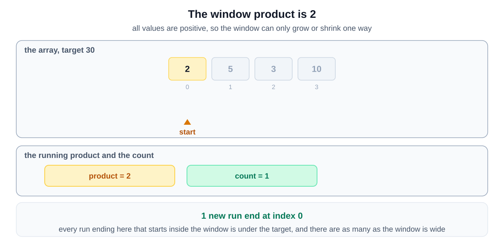
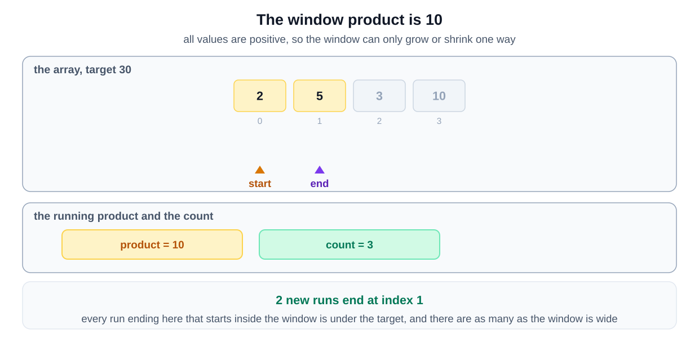
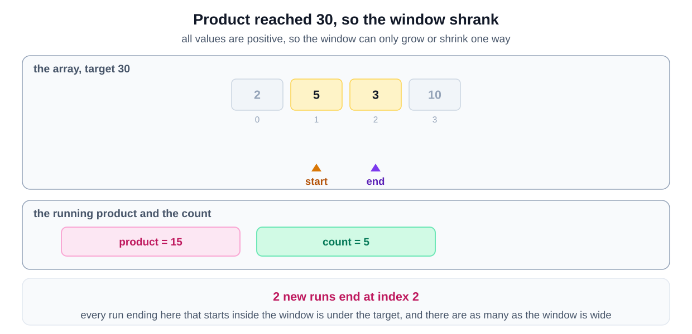
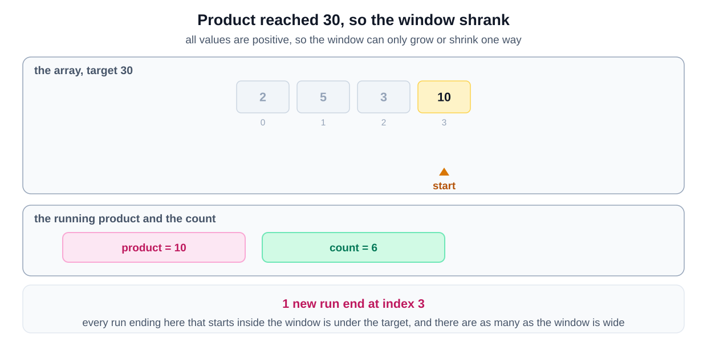
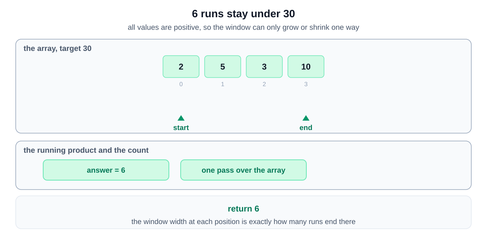

## Why this is a Sliding Window problem

| What the question says | The signal it matches |
|---|---|
| "count of contiguous subarrays whose product is less than the target number" | the ranges are **contiguous** and each must satisfy a condition |
| "an array nums with positive numbers" | extending can only raise the product, so shrinking is the way back |
| multiplying out every subarray | your first idea is **for each starting index, scan forward** |

Every window that ends at the right edge and starts anywhere inside it is legal at once, so they are added in one step. That is the [counting windows variant](/course-play/grokking-the-coding-interview/doc/introduction-to-sliding-window-pattern).

**The closest alternative.** As with Smallest Subarray With a Greater Sum, the word positive is what makes the window valid.

A zero would make every product zero. A negative would let the product shrink as the window grows. Neither edge would then move predictably. Check the constraints for that word before choosing this pattern.
## Solution

To solve the "Subarray Product Less Than Target" problem, we utilize the **Two-Pointer Sliding Window** technique. This approach is highly effective for handling problems involving contiguous subarrays. Here's how it works:

- **Sliding Window Concept**: We maintain a window defined by two pointers, **left** and **right**, which represent the current range of elements under consideration. The window slides through the array to include new elements and exclude old ones based on the product constraint.

- **Maintaining the Product**: As we expand the window by moving the **right** pointer, we multiply the current element to a running **product**. If this product exceeds or equals the **target**, we shrink the window from the left by moving the **left** pointer and dividing the **product** by the element being excluded. This ensures that the product of the elements within the window always remains below the target.

- **Counting Valid Subarrays**: For each position of the **right** pointer, the number of valid subarrays ending at that position is equal to the size of the current window (`right - left + 1`). We accumulate this count in a variable **totalCount**.

### Step-by-Step Algorithm

1. **Initialize Variables**:
   - **totalCount**: Set to `0`. This variable will store the total number of valid subarrays found.
   - **product**: Set to `1`. This will hold the product of elements within the current window.
   - **left**: Set to `0`. This pointer represents the left boundary of the sliding window.

2. **Handle Edge Cases**:
   - If the **target** is less than or equal to `1`, return `0` immediately since no positive product can be less than `1`.

3. **Iterate Through the Array**:
   - **For each index `right` from `0` to `nums.length - 1`**:
     - **Update Product**:
       - Multiply **product** by `nums[right]` to include the current element in the window.

     - **Adjust the Left Boundary**:
       - **While** **product** is greater than or equal to **target** and **left** is still inside the array:
         - The code writes this second test as `left < nums.length`. It never fires on its own, because an empty window has a product of `1`, and the loop already stopped once the product fell below the target. Writing `left <= right` instead gives the same answer on every input.
         - Divide **product** by `nums[left]` to exclude the leftmost element from the window.
         - Increment **left** by `1` to shrink the window from the left.
         - This step ensures the product of the current window remains below the target by removing elements that cause the product to exceed the target.

     - **Calculate Valid Subarrays**:
       - Add `(right - left + 1)` to **totalCount**. This represents the number of new subarrays ending at index `right` that have a product less than the target. Each element from `left` to `right` forms a valid subarray.

4. **Return the Result**:
   - After completing the iteration, return **totalCount** as the total number of valid subarrays.

### Algorithm Walkthrough

Let's walk through the algorithm using the input `nums = [2, 5, 3, 10]` and `target = 30`.

