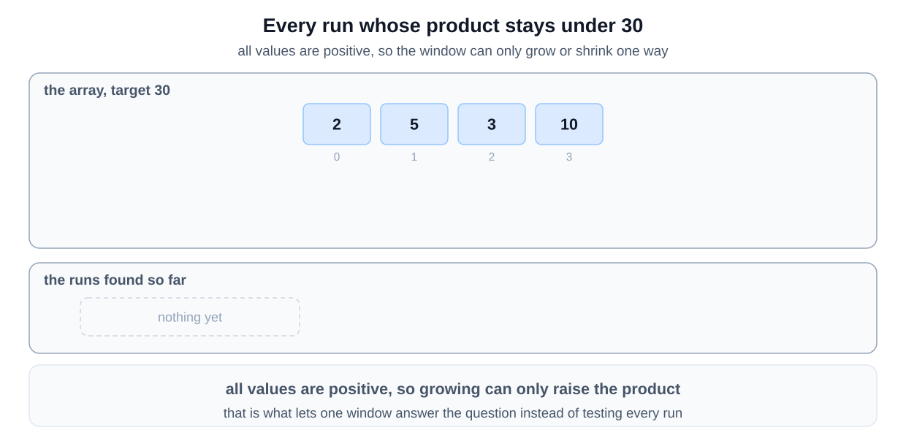
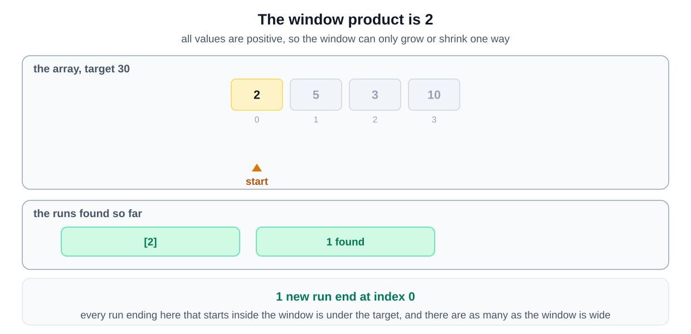
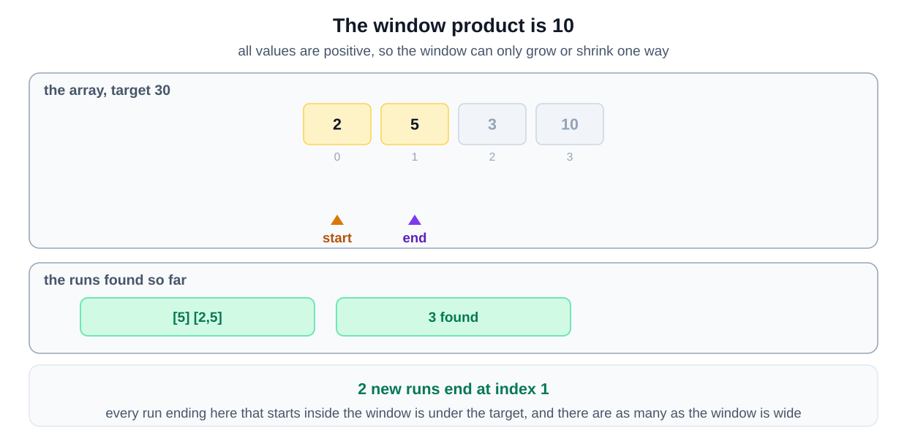
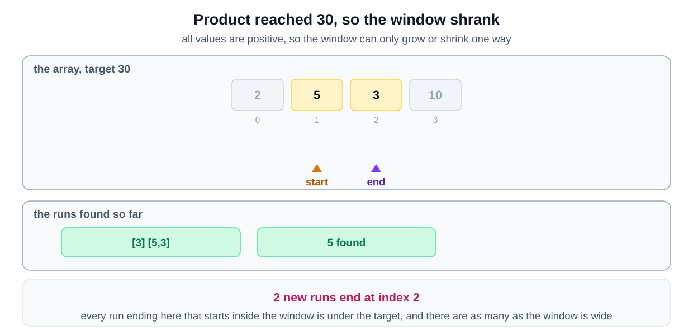
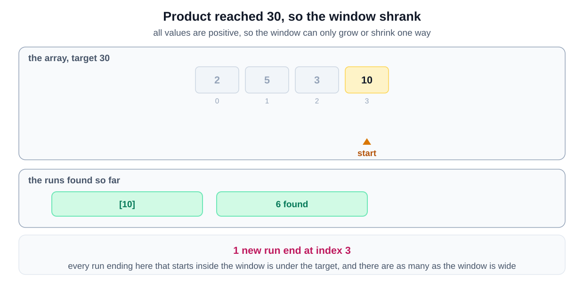
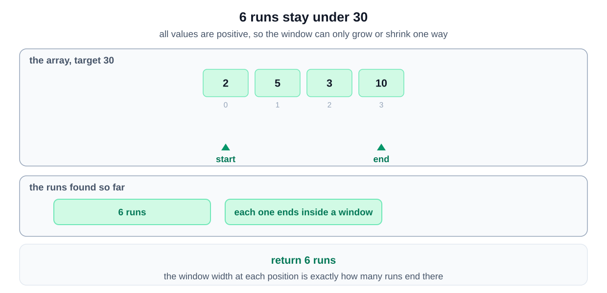

## Why this is a Sliding Window problem

| What the question says | The signal it matches |
|---|---|
| "find all of its contiguous subarrays whose product is less than the target number" | the ranges are **contiguous** and each must satisfy a condition |
| "an array with positive numbers and a positive target number" | extending can only raise the product, so shrinking is the way back |
| multiplying out every subarray | your first idea is **for each starting index, scan forward** |

The window is the same as in the counting version, and each legal window is listed rather than tallied. That is the [counting windows variant](/course-play/grokking-the-coding-interview/doc/introduction-to-sliding-window-pattern).

**The closest alternative.** There is none, but the cost is worth stating. The question notes that this is the previous problem asking for the subarrays rather than the count.

Listing them cannot be linear. The answer can hold on the order of `N` subarrays, and writing them out costs that much. The window still finds them in one pass. The extra time goes into producing the output, not into searching.

## Solution

This shares its shape with Triplets with Smaller Sum, with two differences:

1. In this problem, the input array is not sorted.
2. Instead of finding triplets with sum less than a target, we need to find all subarrays having a product less than the target.

The implementation will be quite similar to Triplets with Smaller Sum. Here is a step-by-step explanation of the algorithm:

1. The goal of this algorithm is to find all subarrays of a given integer array where the product of the numbers in the subarray is less than a specified target value.

2. The algorithm uses a sliding window approach combined with a two-pointer method. A "window" of subarray is defined between the indices pointed to by two pointers, `left` and `right`.

3. The window starts from the leftmost side of the array (both `left` and `right` at position 0) and slides to the right one element at a time, expanding the window. This expansion is represented by incrementing `right`.

4. As we add a new element into the window (the `right` element), we multiply our current `product` with this new element.

5. If at any point the `product` of the numbers within the window (from `left` to `right`) becomes greater than or equal to the `target`, we need to make the product smaller. This is achieved by moving the `left` pointer to the right (incrementing `left`), effectively excluding the `left` element from our window, and dividing our `product` by this removed element. We keep doing this until our `product` is less than `target` again.

6. For each position of `right`, we create all possible subarrays that end at `right`, and that have a product less than the `target`. We do this by starting with a subarray that only includes the `right` element, then progressively adding the element to its left, and so on, until we reach the `left` pointer. All of these subarrays are added to the `result`.

7. This process is repeated for each element in the array (each position of `right`), with the `left` boundary being adjusted as necessary.

8. At the end of this process, `result` will contain all possible subarrays that have a product less than the `target`.

In summary, this algorithm slides a window across the array, expanding and contracting this window as necessary, to find all subarrays where the product of the numbers is less than a target value. For each window, it generates all valid subarrays ending at the right edge of the window.

### Algorithm Walkthrough:

